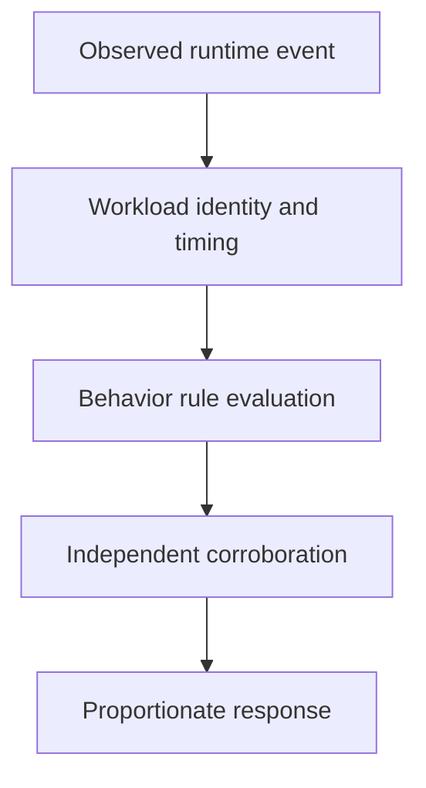

# Behavioral Detection With Runtime Context

A web process launches an unexpected shell after handling a request. Its approved image does not make that new execution legitimate. Runtime evidence describes behavior after startup.

## Learning objectives

- Build an expected behavior model for a workload.
- Relate syscall and process observations to security hypotheses.
- Explain runtime rule scope and detection limitations.

## Before you start

This chapter is standalone reading material; no running cluster or installed tools are required. A Pod is the Kubernetes unit for running one or more containers, and a namespace groups namespaced objects. Treat the worked configurations as teaching examples rather than recorded observations from a provisioned environment.

## Responsible components and behavior

Behavioral detection asks whether a running workload is doing something unexpected or dangerous. It complements static image and configuration assessment because a legitimate image can be exploited after startup. Useful detection combines an expected behavior model with observations of process execution, file access, network activity and identity use.

## Define A Meaningful Baseline

A web application normally accepts requests, reads configuration and communicates with a defined set of dependencies. It may not normally launch an interactive shell, read host credential files or contact an unfamiliar external destination. Those differences can support detection rules, but the baseline must include legitimate startup and maintenance behavior. A rule based on incomplete assumptions can generate noisy alerts or miss the actual important deviation.

Expected behavior is not simply the average of all observed behavior. A compromised workload can contaminate a learned baseline. Define allowed responsibilities using application knowledge, then use observed variation to refine the model. Distinguish approved exceptional activity from a permanently broad exception that disables useful detection.

## Connect Runtime Events To Identity

Runtime sensors can observe system calls or process activity using mechanisms such as kernel instrumentation. A tool such as Falco evaluates events against rules describing suspicious conditions. The useful record includes the process, executable, operation, container identity, node and timing. Kubernetes metadata can connect a low-level event to a Pod, namespace and workload owner.

Names alone can be reused after replacement. Include durable identifiers and lifecycle context so an event from an earlier Pod is not attributed to its later replacement. Sensor placement and enrichment determine what context is available. An event with missing metadata may still be relevant, but the investigation must acknowledge the attribution limitation.

## Interpret A Rule Match

Suppose a runtime rule reports a shell spawned by a request-serving container. The first hypothesis might be command injection. Correlate the parent process, request timing, executable and any approved maintenance action. A shell invoked by a documented startup wrapper has different meaning from one launched after a suspicious input and followed by an unexpected network connection.

A rule match does not establish that the operation was blocked. Detection and prevention are separate responsibilities. Some systems can trigger response actions, but the response must be configured and its actual effect established. Likewise, no alert does not prove the absence of malicious activity when the relevant event source was disabled or the rule did not cover the operation.

## Correlate Across Boundaries

Process observations describe local execution. Network records can identify dependency access or outbound connections. Kubernetes audit records can identify API calls used to create workloads, read data or change permissions. Application logs can show the initiating request. Combining these sources supports a stronger explanation than treating one suspicious filename as the whole incident.

Collection itself has costs and limits. Event loss, sampling, disabled sources and retention can leave gaps. Sensitive file paths, arguments and payloads may contain confidential data. Restrict access to detection records and retain only the detail justified by investigation needs.

## Choose A Proportionate Response

A response can isolate a workload, restrict a credential or preserve evidence for analysis. Replacing a Pod may stop one process but also erase volatile evidence, and a compromised controller template may recreate the same behavior. Evaluate the owner, credentials and related workloads before claiming containment. Document the observed facts separately from hypotheses, and confirm whether the suspicious activity and its authority have actually been removed.

## Work through the decision

A runtime sensor observes supported process, filesystem or network events and connects them to workload context. Falco can evaluate relevant events against configured rules. A rule match signals a condition worth investigation, not proof of every inferred attack step.

Define expected behavior from the application's responsibility, including authorized maintenance. Then identify the process, container instance, node and observation time. Reused names and missing enrichment can misattribute an event to a later Pod. Check sensor coverage and correlate the alert with independent request or audit evidence before selecting proportionate containment. A quiet dashboard cannot establish that unsupported behavior never occurred.

Runtime detection becomes useful evidence through accurate context, known coverage and verified interpretation.

Runtime detection becomes useful evidence through accurate context, known coverage and verified interpretation.

## Common pitfalls

> [!WARNING]
> A detection alert is neither automatic prevention nor complete incident proof. Baselines, event coverage, workload identity and corroborating evidence determine what the observation supports.
