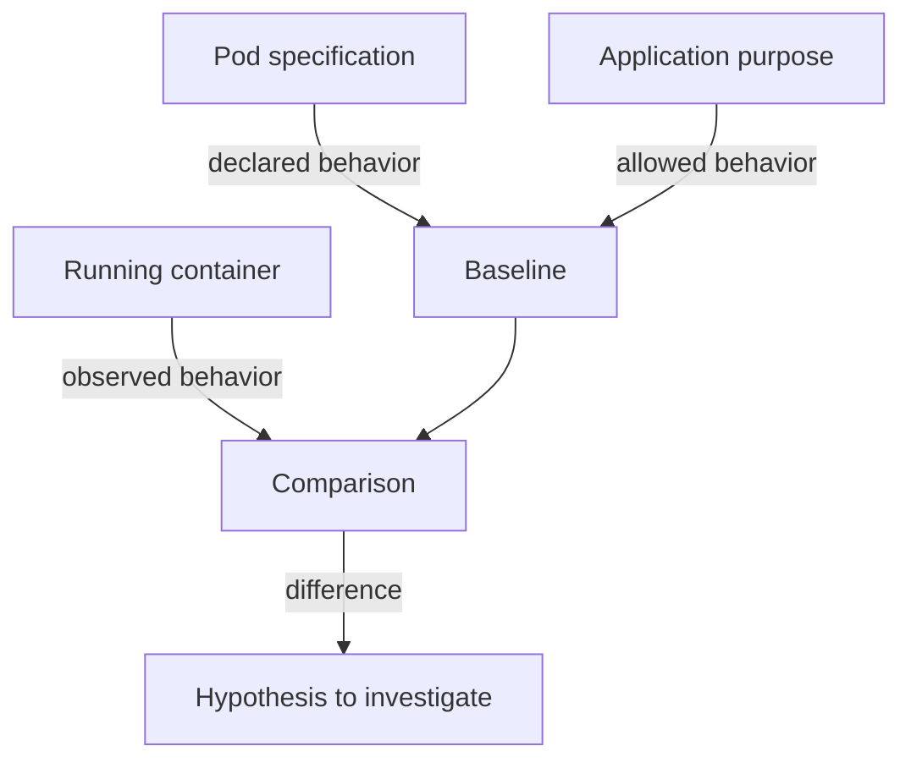

# Expected Behavior Of A Workload

Behavioral detection needs a reference. An alert that says "a process started" means nothing until you know which processes the workload starts on a normal day. This part builds that reference for the `probe` workload from two sources: what the Pod specification declares, and what the container actually runs. The result is a short list of expected behaviors that a detection rule can test.

## What a baseline contains

A baseline is the set of behaviors that you accept for a workload. A useful baseline covers five areas:

- **Processes.** The executable that runs as the main process, and any child processes it starts.
- **Files.** The paths it reads, the paths it writes, and the paths it must never touch.
- **Network.** The destinations it connects to and the ports it listens on.
- **Identity.** The ServiceAccount it uses and the Kubernetes API calls that identity makes.
- **System calls.** The kernel operations behind the first four, such as `execve`, `open`, `connect` and `accept`.

Application knowledge sets the baseline. A web server listens on one port and answers requests. It does not normally start an interactive shell, read `/etc/shadow`, or call the Secrets API. Those differences are what rules test.

A baseline learned only by watching the workload can be wrong. If the workload is already compromised during the learning period, the attacker's behavior becomes part of the baseline. Write the baseline from the specification and the application's purpose first, then use observation to correct it.

## Read the declared behavior

The Pod specification already states part of the baseline. The Deployment declares the command, the port and the ServiceAccount. Run these commands from your host shell. The first line selects the playground cluster, and the second line should print `kind-astro-ats-036-playground-010-01`.

<!-- astrona:playground:renew -->

```sh
export KUBECONFIG="$(astrona kubeconfig ats-036-playground-010-01)"
kubectl config current-context
```

The command that the `probe` container runs:

```sh
kubectl -n starfleet get deployment probe -o jsonpath='{.spec.template.spec.containers[0].command}{"\n"}'
```

It prints a list with two entries, `python` and `/app/server.py`. The main process is therefore the Python interpreter running the web server, and nothing in the specification starts a shell.

Next, read the port and the ServiceAccount:

```sh
kubectl -n starfleet get deployment probe -o jsonpath='{.spec.template.spec.containers[0].ports[0].containerPort}{"\n"}{.spec.template.spec.serviceAccountName}{"\n"}'
```

The first line is the port `8080`. The second line is empty, because the Deployment does not set `serviceAccountName`; the Pods use the `default` ServiceAccount of the `starfleet` namespace. That ServiceAccount has no permissions of its own, so a baseline for `probe` says: no calls to the Kubernetes API.

## Compare with the running container

The specification says what should run. The container shows what does run. `kubectl exec` starts a new process in a running container, and `ps` lists the processes of that container.

```sh
kubectl -n starfleet exec deploy/probe -- ps
```

The list contains the web server as process 1 with the command line `python /app/server.py`, plus the `ps` command that you just started. If another process appeared in this list, for example a `sh` that nobody on your team started, it would not match the baseline.

The network behavior is the second thing to confirm. The `shuttle` Pod sends a request to the `probe` Service:

```sh
kubectl -n starfleet exec shuttle -- wget -qO- -T 3 http://probe.starfleet.svc
```

The response is one line of text that starts with `version=v1 host=` and ends with `greeting=hello`. This is the normal behavior: a client in the same namespace asks for the page and the web server answers.

Now run a command that a web server does not need. It starts a shell and asks for the user ID:

```sh
kubectl -n starfleet exec deploy/probe -- sh -c 'id'
```

The output shows user ID 0, which is `root`. The image runs as root because the Pod specification does not set `runAsUser`. The command itself worked, and nothing in Kubernetes reported it. This is the gap that behavioral detection fills: Kubernetes allowed a legitimate `exec`, and only a sensor that watches process creation, or an audit rule for `pods/exec`, can report it.



The diagram shows that the baseline comes from the specification and the application purpose, and the running container is compared with it.

## Legitimate exceptions

Some behaviors are unusual but approved. An administrator who debugs a Pod with `kubectl exec` starts a shell. A start-up script may run `sh` once when the container begins. A rule that ignores every shell would miss attacks, and a rule that reports every shell would produce alerts that people stop reading.

Record each exception with its limits: which Pod, which user, which parent process and which time window. A narrow exception keeps the rule useful. The baseline now holds the expected processes, port, identity and approved exceptions for `probe`. The next question is how a sensor sees those behaviors at all, which depends on the system calls that the kernel handles.

## Common pitfalls

> [!WARNING]
> - **Learning the baseline from a compromised workload.** Observed behavior can include the attacker. Start from the specification and the application purpose.
> - **Treating `exec` as an attack.** A shell started with `kubectl exec` is a normal maintenance action. The signal is a shell that no approved user or process started.
> - **Writing one baseline for all Pods of a namespace.** `probe`, `shuttle` and `drifter` do different work. A baseline belongs to one workload.
> - **Assuming Kubernetes reports unusual processes.** Kubernetes does not log which processes run inside a container. A runtime sensor or an audit rule for `pods/exec` must provide that record.
