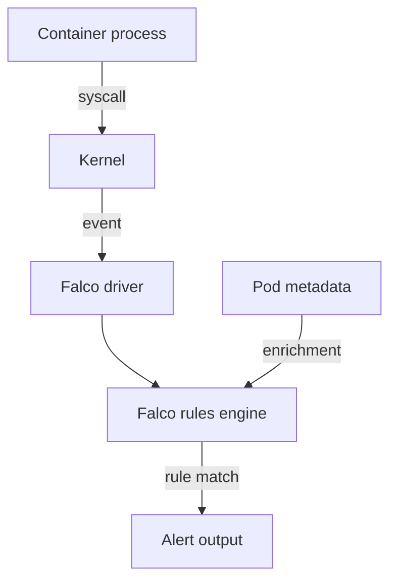

# Syscalls, eBPF And Falco Rules

A baseline is only useful if something can watch the workload and compare. Kubernetes does not watch processes inside containers, so a separate runtime sensor does it. This part explains where such a sensor gets its events, how Falco turns them into alerts, and how to read a Falco rule. Falco is not installed in the playground. You will read and understand its rules here, and you will confirm in the playground the one fact that makes this approach work: all containers on a node share one kernel.

## Why a node sensor sees every container

A system call (syscall) is a request from a process to the kernel: open a file, start a program, open a network connection. A container is not a virtual machine. It is a normal Linux process with its own namespaces, and it makes syscalls to the same kernel as every other process on the node.

Check this in the playground. The first command asks a `probe` container for the kernel release, and the second asks the worker node container:

<!-- astrona:playground:renew -->

```sh
export KUBECONFIG="$(astrona kubeconfig ats-036-playground-010-01)"
worker_name="astro-ats-036-playground-010-01-worker"
kubectl -n starfleet exec deploy/probe -- uname -r
podman exec "$worker_name" uname -r
```

Both commands print the same kernel release. The `probe` container has no kernel of its own. A sensor that watches syscalls on the node therefore sees the syscalls of every container on that node, and it can tell them apart by the container identifier that the kernel attaches to each process.

## How Falco gets events

Falco is a runtime security tool that evaluates syscall events against rules. In Kubernetes it runs as a DaemonSet, which starts one Falco Pod on every node. The data path has four steps:

1. A **driver** in the kernel captures syscall events. Falco supports a kernel module, an eBPF probe and a modern eBPF probe. eBPF (extended Berkeley Packet Filter) is a way to run small verified programs inside the kernel without a kernel module.
2. The Falco process in user space reads the events from the driver.
3. Falco **enriches** each event. It looks up the container ID through the container runtime and the Pod name and namespace through Kubernetes metadata.
4. The **rules engine** tests the event against every enabled rule. A matching rule produces an alert that Falco sends to its outputs: standard output, a file, syslog, an HTTP endpoint or a gRPC client.



The diagram shows that the driver and the Kubernetes metadata both feed the rules engine, and only a rule match produces an alert.

Other tools use the same idea. Tracee is an open source runtime security tool that uses eBPF and ships detection signatures. Sysdig is a command-line tool that captures syscalls with filters, and it is the technology under Falco. Falco is the tool the exam names most often, so the rest of this part uses it.

## Anatomy of a rule

A Falco rule is a YAML list entry with a name, a condition and an output. Here is a rule for the baseline of `probe`: no shell should start in it. The playground does not run this rule. It is shown so you can read each field.

```yaml
- rule: Shell Started In Probe Container
  desc: A shell process started in a container of the probe workload
  condition: >
    evt.type in (execve, execveat) and evt.dir = < and
    container.id != host and
    proc.name in (sh, bash, ash) and
    k8s.ns.name = starfleet and k8s.pod.label.app = probe
  output: >
    Shell started (user=%user.name command=%proc.cmdline
    pod=%k8s.pod.name namespace=%k8s.ns.name container=%container.name
    image=%container.image.repository)
  priority: WARNING
  tags: [container, shell, mitre_execution]
```

The fields work like this:

- `rule` is the name. It appears in every alert and in overrides.
- `desc` says what the rule detects.
- `condition` is a filter over event fields. `evt.type in (execve, execveat)` selects calls that start a program, and `evt.dir = <` selects the exit of the call, when the result is known. `proc.name` is the executable name. `k8s.ns.name` and `k8s.pod.label.app` come from the Kubernetes enrichment.
- `output` is the alert text. Placeholders such as `%proc.cmdline` and `%k8s.pod.name` are filled from the event.
- `priority` is one of `EMERGENCY`, `ALERT`, `CRITICAL`, `ERROR`, `WARNING`, `NOTICE`, `INFORMATIONAL` and `DEBUG`.
- `tags` group rules, for example by MITRE ATT&CK tactic.

Falco ships default rules in `falco_rules.yaml` and reads your own rules from the files named in the `rules_files` list of `falco.yaml`. Rules are written from small parts. A **macro** is a named condition fragment that other conditions reuse, and a **list** is a named set of values such as `(sh, bash, ash)`. The default rules define the macro `spawned_process`, which is the same test as the first line of the condition above.

## What the playground can show

Falco is not running, so the next command raises no alert. It does create the event that the rule above would match. The shell is the `sh` that `kubectl exec` starts in the `probe` container:

```sh
kubectl -n starfleet exec deploy/probe -- sh -c 'ls /app'
```

The output is the file name `server.py`, because the web server code is mounted at `/app`. In a cluster with the rule loaded, Falco would see an `execve` of `sh` in a Pod labelled `app=probe`, and it would write an alert with the `WARNING` priority that names the Pod, the namespace and the command line. Without a sensor, the only trace is the API request that created the exec session, and that request is not recorded unless an audit rule asks for it.

## Rules also have limits

A rule only sees what its driver and its fields can see. A syscall sensor does not see the contents of encrypted network traffic. It does not see a process that runs on a node without a Falco Pod. A rule written for `execve` does not match a shell that already runs and receives commands over a network connection. Event drops can also happen when the kernel produces events faster than Falco reads them.

Detection is not prevention. A rule match writes an alert. The shell has already started when the alert arrives. Prevention needs a separate control, such as a seccomp profile, an AppArmor profile or a read-only root filesystem. You now know how a sensor sees a process and how a rule describes it. The Kubernetes API is a second place where behavior leaves a trace, and the next part reads it.

## Common pitfalls

> [!WARNING]
> - **Matching only `proc.name`.** An attacker can rename a binary. Combine the name with the parent process, the user and the container context.
> - **Forgetting the direction of the event.** A syscall has an entry and an exit event. Use `evt.dir = <` for the exit when the rule needs the result.
> - **Writing a rule without a Kubernetes scope.** A rule without a namespace or label test fires on every container on the node, including system Pods.
> - **Reading an alert as proof of prevention.** The alert says that the event happened. It does not say that anything stopped it.
