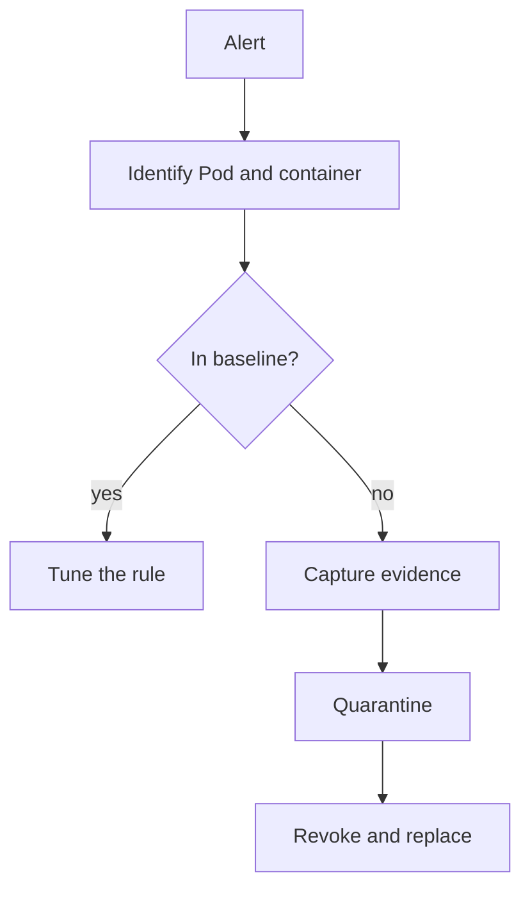

# Triage, Tuning And Response To An Alert

An alert starts an investigation; it does not finish one. A team that receives an alert has to decide three things quickly: is it real, does the rule need a change, and what to do first. If it responds by deleting the Pod, it can destroy the evidence it needs. This part gives a short triage order, shows how to tune a Falco rule without turning it off, and practices two safe response steps in the playground: capturing evidence and quarantining a Pod.

## Triage in order

Triage means sorting alerts by what they most likely mean. Ask these questions in order, and write down each answer as a fact or as a hypothesis:

1. **Which workload?** Take the Pod, namespace, container and node from the alert, and the container ID or Pod UID if the alert has one. A Pod name can be reused after a replacement.
2. **Is this behavior in the baseline?** An approved maintenance `exec` is expected. A shell in a web server that nobody opened is not.
3. **What happened just before and after?** Look at the parent process, the request that arrived before, and any new network connection afterwards.
4. **What identity is involved?** Check which ServiceAccount the Pod uses and whether it made unusual API calls.
5. **Is the sensor trustworthy for this event?** A missing alert can mean missing coverage, not a clean workload.



The diagram shows that an alert that is not in the baseline leads to evidence capture before quarantine, revocation and replacement.

## Tune a rule without disabling it

A rule that raises false positives gets ignored, so tuning is part of detection work. The wrong fix is to disable the rule. The right fix narrows the condition so that the approved case no longer matches and every other case still does.

Falco lets you extend a rule in your own rules file. With `override` and `condition: append`, Falco adds text to the condition of the rule with the same name. Suppose the start-up script `healthcheck.sh` of the `probe` workload starts a shell once. This entry excludes only that parent process:

```yaml
- rule: Shell Started In Probe Container
  condition: and not proc.pname = healthcheck.sh
  override:
    condition: append
```

Falco also supports `exceptions` in a rule. An exception lists fields and values, such as a user name and a parent process, that do not trigger the alert. Both ways keep the rule active. A good exception is narrow, has an owner, and gets removed when the cause is gone.

## Capture evidence first

Some evidence exists only while the container runs: the process list, open connections and files in a temporary directory. When you delete the Pod, that state is gone. Capture the cheap and stable evidence first. Run these commands from your host shell:

<!-- astrona:playground:renew -->

```sh
export KUBECONFIG="$(astrona kubeconfig ats-036-playground-010-01)"
kubectl -n starfleet get pod shuttle -o yaml > shuttle-evidence.yaml
kubectl -n starfleet logs shuttle --timestamps > shuttle-logs.txt
```

The first file holds the complete Pod object: its labels, its ServiceAccount, its node and its container status. The second file holds the container log with a timestamp on every line. The `shuttle` container only sleeps, so the log file is empty. For a real web workload the log is the first place to look for the request that started the incident.

To look inside the running container without changing it, add an ephemeral container. An ephemeral container is a temporary container that you add to a running Pod for debugging. You cannot remove it later, and it does not restart.

```sh
kubectl -n starfleet debug shuttle --image=docker.io/library/busybox:1.37.0 --target=client --container=evidence -- ps
kubectl -n starfleet logs shuttle -c evidence
```

The `--target=client` option asks the container runtime to place the new container in the process namespace of the `client` container. When the runtime supports this, the `ps` output lists the processes of `client`, including `sleep 3600`. Wait a few seconds if the log is empty, because the ephemeral container must start first.

## Quarantine without deleting

If the Pod is suspicious, you often want to keep it running for analysis but stop traffic to it. A Deployment and a Service select Pods by labels. When you change the label that they select, the Pod leaves both. The ReplicaSet notices that one Pod is missing and creates a replacement, and the original Pod stays untouched.

Find one `probe` Pod and change its `app` label:

```sh
suspect_pod="$(kubectl -n starfleet get pods -l app=probe -o jsonpath='{.items[0].metadata.name}')"
kubectl -n starfleet label pod "$suspect_pod" app=probe-quarantine --overwrite
kubectl -n starfleet get pods -L app
```

After a few seconds the listing shows three `probe` Pods. Two have `app=probe`, and the one that you labelled has `app=probe-quarantine`. The Service sends no new requests to the quarantined Pod, and the Deployment no longer counts it as one of its replicas. A NetworkPolicy that selects `app=probe-quarantine` could also block all its traffic, if the cluster network plugin enforces NetworkPolicy.

Quarantine does not remove the cause. The new replacement uses the same Pod template, so it behaves like the original. If the template or the image is compromised, you must also fix the Deployment. If the ServiceAccount token was used, revoke what the ServiceAccount can do. When the analysis is done, delete the quarantined Pod:

```sh
kubectl -n starfleet delete pod "$suspect_pod"
```

You now have the full loop for this module: define the baseline, detect a deviation with a sensor or an audit record, triage the alert, tune the rule, and respond in an order that keeps the evidence.

## Common pitfalls

> [!WARNING]
> - **Deleting the Pod first.** A deleted Pod loses its process list, its network connections and its temporary files. A controller also creates a new Pod from the same template.
> - **Disabling a noisy rule.** This removes detection for the attack the rule was written for. Add a narrow exception instead.
> - **Quarantining with a label and stopping there.** The compromised template and the ServiceAccount permissions stay unchanged.
> - **Adding an ephemeral container and expecting to remove it.** An ephemeral container stays in the Pod specification until the Pod is deleted.
