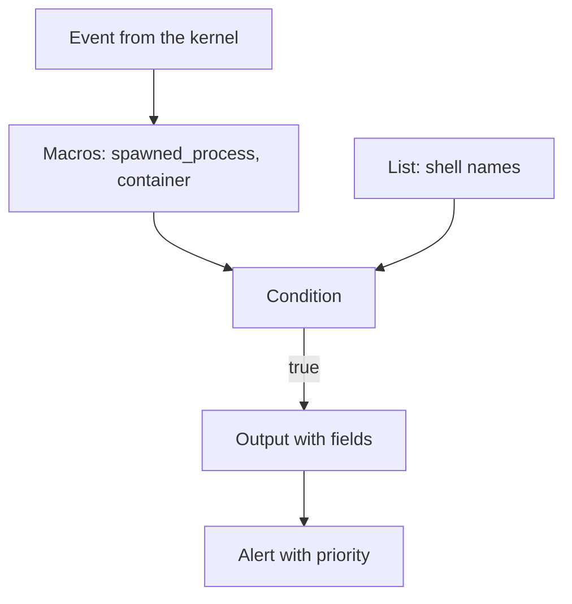

# Anatomy Of A Falco Rule File

A rule is a small program that a sensor runs against every event. If the program is too broad, it reports normal work. If it is too narrow, it misses the attack. This part explains the building blocks of a Falco rule file and then uses the running `probe` container to choose realistic values for them.

## The three kinds of entry

Falco (a runtime security sensor for Linux) reads rules from YAML files. A rule file is a list, and each entry has one of three kinds.

A **rule** is a detection. It has a `rule` name, a `desc` that explains it, a `condition` that decides when it fires, an `output` that formats the alert and a `priority`. It can also have `tags` and `exceptions`.

A **macro** is a named piece of condition. The macro `spawned_process` means that a new process was created, and the macro `container` means that the event happened inside a container. A rule that uses a macro stays short, and the definition lives in one place.

A **list** is a named list of values. A list of shell names can be used in many conditions, so a change to the list changes every rule that uses it.

The `condition` is a boolean expression over event fields. A field is written as a class and a name, for example `proc.name` (the name of the process), `proc.cmdline` (the full command line), `proc.pname` (the name of the parent process), `k8s.ns.name` (the namespace of the Pod), `k8s.pod.name` (the name of the Pod) and `user.name` (the user that runs the process). In the `output`, a field is written with a percent sign, for example `%proc.cmdline`.



The diagram shows that macros and lists feed the condition, and only an event for which the condition is true produces an alert.

## Choose values from the running container

Write the values of a rule from what the workload really runs. Select the playground cluster first.

<!-- astrona:playground:renew -->

```sh
export KUBECONFIG="$(astrona kubeconfig ats-036-playground-010-02)"
kubectl config current-context
```

The command prints `kind-astro-ats-036-playground-010-02`. List the processes of a `probe` container:

```sh
kubectl -n starfleet exec deploy/probe -- ps
```

The web server is process 1, started as `python /app/server.py`. The `ps` command is the process that `kubectl exec` just started, and it exits after it prints. A rule for this workload therefore has a clear target: any process in the `starfleet` namespace whose name is a shell is new behavior.

Now read which namespaces and labels exist, so that the rule can use stable names:

```sh
kubectl get pods -A --show-labels
```

Pods carry labels, and the Kubernetes fields in a Falco rule come from the container runtime and the API server. The namespace name is the most stable of these fields. A Pod name changes with every rollout, so a rule should not depend on one Pod name.

## Priority and tags

The priority says how serious the alert is: `EMERGENCY`, `ALERT`, `CRITICAL`, `ERROR`, `WARNING`, `NOTICE`, `INFORMATIONAL` or `DEBUG`. A shell in a production container is usually `WARNING` or `NOTICE` because administrators also start shells, and a write below a system directory is usually `ERROR` or higher. Tags group rules, for example `container`, `shell` and `mitre_execution`, so an operator can enable or disable a group.

A rule with the right structure but the wrong scope is still a bad rule. The next part builds one rule and limits it step by step. The question this part leaves open is how narrow the condition should be.

## Common pitfalls

> [!WARNING]
> - **Using a Pod name in a condition.** Pod names change with every rollout. Use the namespace, the container name or a label.
> - **Copying a rule without reading its macros.** A macro hides part of the condition. Read the macro definition to know what the rule really tests.
> - **Alerting without context.** An output that does not include the pod, the process and the command line forces the analyst to search before triage can start.
> - **Expecting Falco to read a ConfigMap.** Falco loads rule files from disk. A ConfigMap must be mounted into the Falco Pods before the rules apply.
