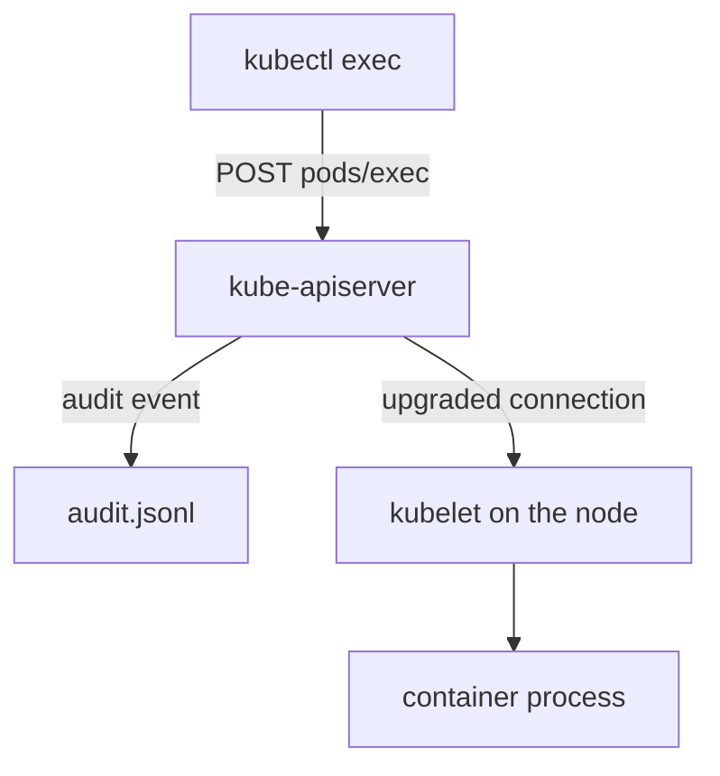

# Exec And Port-Forward In The Audit Log

Two API operations let a person reach inside a Pod: `exec` runs a command in a container, and `portforward` opens a network path from the client to a Pod. Neither operation is a change to a Kubernetes object, so a log that only records object changes misses both. This part shows the audit policy rule that records them and finds a real `exec` request in the playground.

## Subresources and the audit policy

The API server exposes a Pod at `pods`, and it exposes actions on that Pod as subresources: `pods/log`, `pods/exec`, `pods/portforward` and others. An audit policy rule that lists the resource `pods` matches the Pod itself and does not match its subresources. A subresource must be listed by its own name, for example `pods/exec`.

The audit policy is the list of rules that tells the API server what to record. Read the policy of the playground:

<!-- astrona:playground:renew -->

```sh
export KUBECONFIG="$(astrona kubeconfig ats-036-playground-010-03)"
node_name="astro-ats-036-playground-010-03-control-plane"
podman exec "$node_name" cat /etc/kubernetes/training-audit-policy.json
```

The first rule uses the level `Metadata` for the namespace `starfleet` and for the resources `secrets`, `configmaps`, `pods`, `pods/exec` and `pods/portforward`. The last rule uses the level `None`, so every other request is not recorded. The API server uses the first rule that matches. The level `Metadata` records who, what, when and the result, and it does not record request or response bodies.

## Produce and find an exec request

Run a command in a `probe` Pod. The command is harmless: it prints the user ID.

```sh
kubectl -n starfleet exec deploy/probe -- sh -c 'id'
```

Now filter the audit log for requests on the `exec` subresource. The program reads the log from standard input and prints one line for each matching event.

Save this as `exec-report.py`:

```python
import json
import sys

for line in sys.stdin:
    line = line.strip()
    if not line:
        continue
    event = json.loads(line)
    reference = event.get("objectRef", {})
    if reference.get("subresource") != "exec":
        continue
    print(
        event.get("stageTimestamp"),
        event.get("auditID"),
        event.get("stage"),
        event.get("user", {}).get("username"),
        event.get("verb"),
        reference.get("namespace"),
        reference.get("name"),
        event.get("requestURI"),
    )
```

Run it against the log from the node:

```sh
podman exec "$node_name" cat /var/log/training-audit/audit.jsonl | python3 exec-report.py
```

Each line is one audit event for one `exec` request. The verb is `create` and the resource name is the name of the Pod that received the request. The `requestURI` ends with the query parameters of the request, and the requested command appears as `command=` parameters. Look at the `stage` column: an `exec` request keeps a connection open, so check which stages your log contains and use the `auditID` to match the events of one request.



The diagram shows that the API server records the request before it hands the connection to the kubelet, and the command runs on the node, outside the audit log.

The audit event proves that an identity asked the API server to open an `exec` session to a Pod. The question that remains is who that identity is and where the request came from.

## Common pitfalls

> [!WARNING]
> - **Listing only `pods` in the policy.** Subresources such as `pods/exec` are not matched and nothing is recorded.
> - **Searching by the resource name `exec`.** The resource is `pods`; `exec` is in the `subresource` field.
> - **Reading the command from the log as proof of what ran.** The `requestURI` shows the requested command, not its output or its effect.
> - **Expecting one line per request.** A request can produce events for more than one stage. Match them by `auditID`.
