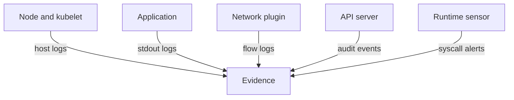

# Security Signals By Layer

A threat in a cluster can start in many places: a node that someone logged in to, a vulnerable application, a Pod that scans the network, a Secret that is read, or a user account that is misused. No single log covers all of them. This part lists the layers of the environment, names the evidence source for each, and then reads the sources that exist in the playground.

## Six layers and their sources

Each layer has its own components, so each has its own evidence. The table names the main source for each layer in a Kubernetes cluster.

| Layer | Example threat | Evidence source |
| --- | --- | --- |
| Physical and node infrastructure | Someone logs in to a node, or a node process is changed | Operating system logs on the node, the kubelet log, host audit records, the cloud provider or data center access log |
| Applications | A request exploits the web application | Application logs written by the container to standard output |
| Networks | A Pod scans or connects to another Pod | Network flow logs from the network plugin, DNS logs, ingress and proxy access logs, NetworkPolicy deny logs |
| Data | A Secret is read or a volume is copied | Kubernetes audit events for Secrets, access logs of the data store, file access events from a runtime sensor |
| Users | A stolen credential calls the API | Kubernetes audit events: the authenticated user, source address and verb |
| Workloads | A container starts a shell or restarts in a loop | Kubernetes events, container logs, restart counts, and runtime sensor events such as Falco alerts |

The table shows that Kubernetes itself provides few of these sources. It provides events, container logs, Pod status and, when you enable it, the audit log. Everything else comes from the node, from the network plugin or from tools that you add.



The diagram shows five components that each produce their own kind of evidence, and no component produces all of it.

## What the playground gives you

Start with the sources that Kubernetes keeps. Run these commands from your host shell. The first line selects the playground cluster, and the second prints its name, which should be `kind-astro-ats-036-playground-020-01`.

<!-- astrona:playground:renew -->

```sh
export KUBECONFIG="$(astrona kubeconfig ats-036-playground-020-01)"
kubectl config current-context
```

The nodes and the Pods that run on them:

```sh
kubectl get nodes -o wide
kubectl get pods -A -o wide
```

The second command lists the node of every Pod. This matters in an investigation, because the host evidence for a Pod is on the node where it ran. Kubernetes events are the next source. An event is a short record that a component creates when something happens to an object, such as a Pod being scheduled or a container being killed:

```sh
kubectl get events -A --sort-by=.lastTimestamp
```

The list contains events for the start of the `probe` Pods and for `crash-report`, which was started again after each exit. After several restarts you also see a `BackOff` event for it. Events are stored in the cluster for a short time. The API server option `--event-ttl` sets that time, and its default is one hour, so events cannot serve as long-term evidence.

## Node evidence

A container log is a file on the node. The kubelet, the node agent that starts Pods, writes the log of each container under `/var/log/pods`. The directory name has the form `<namespace>_<pod>_<uid>`. The kubelet also writes its own log into the journal of the node. Read both from the worker node container:

```sh
worker_name="astro-ats-036-playground-020-01-worker"
podman exec "$worker_name" ls /var/log/pods
podman exec "$worker_name" journalctl -u kubelet --no-pager -n 5
```

The first command lists one directory for each Pod that runs on the worker, including `starfleet_crash-report_` followed by the Pod UID. The second prints the last five lines of the kubelet log, which records container starts, probe failures and volume mounts. Someone who has access to the node can read and delete these files. A node that an attacker controls cannot be trusted as the only source of its own evidence.

## Layers that need more than the playground

The audit log, flow logs and runtime events are not enabled here. In a production cluster, a log collector runs on every node, reads the files under `/var/log/pods` and ships them to storage outside the node. A runtime sensor watches system calls. The network plugin can record flows. Each of these is a separate component with its own configuration, and each can fail without Kubernetes reporting it. You now have a map of the sources. The next part reads the most common one closely: the container log and the status of a container that keeps failing.

## Common pitfalls

> [!WARNING]
> - **Expecting one log to cover everything.** Each layer has its own source. Name the layer first, then the source.
> - **Using Kubernetes events as a long-term record.** Events expire after one hour by default.
> - **Trusting only node files.** A person with access to the node can change them. Ship logs to storage outside the node.
> - **Forgetting which node ran the Pod.** Host evidence is on that node. Use `kubectl get pods -o wide` to find it.
