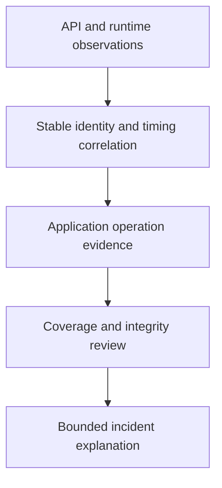

# Security Signals Across Different Boundaries

Audit records show a workload creation, runtime records show a shell, and application logs show a report read. Each observation establishes a different boundary of a possible incident.

## Learning objectives

- Distinguish API audit, runtime and application security observations.
- Explain telemetry collection and retention trust boundaries.
- Relate alert quality to relevant behaviors and response ownership.

## Before you start

This chapter is standalone reading material; no running cluster or installed tools are required. A Pod is the Kubernetes unit for running one or more containers, and a namespace groups namespaced objects. Treat the worked configurations as teaching examples rather than recorded observations from a provisioned environment.

## Responsible components and behavior

An unexpected workload appears, and a confidential report is accessed. application programming interface (API) audit records can explain resource requests, while runtime observations can describe selected process or filesystem activity. Application logs can describe report access. A security investigation needs the sources relevant to the actual boundary rather than assuming one monitoring product records everything.

## What Each Observation Can Establish

An audit event can identify a caller and accepted API change under configured policy. It does not prove that a container later executed a command. A runtime detector can observe supported execution behavior but may lack the user's business identity. An application record can explain a request decision without capturing every node-level action.

Connect observations through timing, resource identity and relevant request context. Shared credentials weaken human attribution because several actors can act under one identity. A record's displayed user therefore needs interpretation alongside credential ownership and the access path.

Missing evidence can reflect sampling, retention, unsupported observation or pipeline failure. A quiet dashboard is not proof that no event occurred. State which behavior the system was capable of observing during the incident window.

## Collection And Retention Trust

Collectors and storage backends have their own credentials, network paths and access controls. An attacker able to disable collection or delete retained records can weaken investigation. Protect those operations and observe failures in the evidence pipeline itself.

Telemetry can contain sensitive input, tokens or response bodies. Restrict fields and readers according to the diagnostic need. Maximum logging detail everywhere can create a new disclosure store. Retention should preserve useful evidence without keeping unnecessary sensitive values indefinitely.

Time alignment and stable identifiers improve reconstruction. An expired audit record or missing trace cannot be recreated simply by restarting a collector after discovery. The operating plan needs realistic retention and a method to detect loss while it happens.

## Alerts And Response

An alert should describe a meaningful condition and have an owner and response path. A sensitive permission change, unexpected privileged workload or unusual credential use can deserve investigation depending on the platform's normal behavior. A rule that flags every routine operation produces noise that can obscure real misuse.

Detection is not prevention. A scanner or alert can report risk while the workload still runs. Some tools can also enforce actions, but their effective operating mode and failure behavior determine whether that occurred. Do not infer blocking from the existence of a detection rule.

## An Evidence-Based Incident

Suppose audit records show an exposed deployment identity created a workload, and runtime evidence shows it accessed a mounted volume. The identity's grants explain resource authority; the mount and backend rules explain data access. Restore trusted state, revoke exposure and assess the affected data. A deletion event alone does not prove confidentiality was preserved.

The security observation design should state its coverage, retention and sensitivity. Its value is a supported account of behavior and a useful response, not the number of installed dashboards or rules.

## Work through the decision

API audit describes supported requests and responses. Runtime sensing describes supported execution activity. Application records describe their own operations and identities. No single source automatically captures every action or proves that all three belong to one actor.

Correlate object identifiers, lifecycle intervals, request context and timing. A ServiceAccount username identifies a presented credential, which may have been stolen; it does not prove the human behind it. Protect collection and retention against deletion or tampering, and avoid copying sensitive bodies into broad diagnostic stores. State missing observation coverage and alternative explanations alongside any reconstructed timeline.

Independent signals strengthen attribution only when their scope, identity and timing actually support the connection.

Independent signals strengthen attribution only when their scope, identity and timing actually support the connection.

## Common pitfalls

> [!WARNING]
> Detection does not imply prevention, and no single signal source records every trust boundary. Missing records and shared identities limit what an investigation can confidently conclude.
