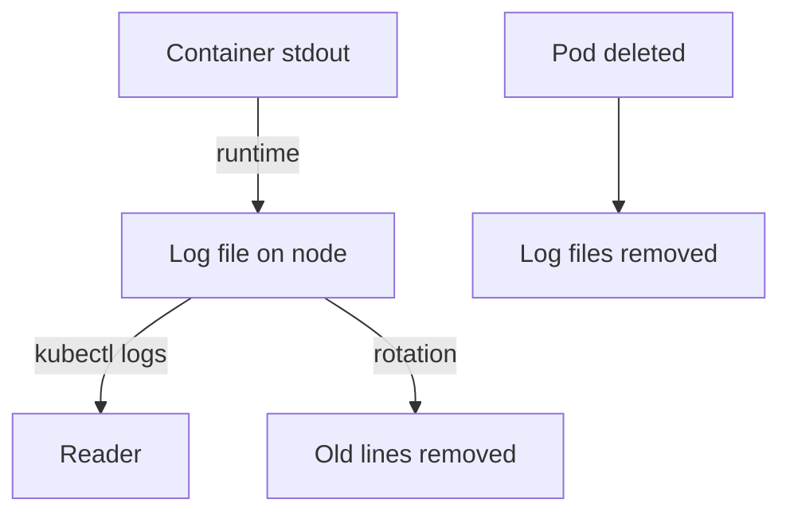

# Workload Logs, Restarts And Exit Evidence

When a container crashes, restarts or behaves strangely, its log and its exit status are the first evidence. Both are easy to lose: a restart replaces the container, and the log of the older instance is the one that explains why it stopped. This part reads the logs and the termination status of the `crash-report` Pod, and it explains where the data comes from and when it disappears.

## Container instances and restarts

A Pod can run the same container several times. When a container exits and the restart policy is `Always` or `OnFailure`, the kubelet starts a new container instance in the same Pod. The Pod keeps its name, IP address and UID. The container ID and the process are new. The Pod status counts the restarts in `restartCount` and keeps the result of the latest finished instance in `lastState`.

The kubelet waits longer between restarts each time, up to five minutes. A Pod in this state shows the status `CrashLoopBackOff`. That status describes the waiting, not the cause. The cause is in the exit code and the log of the instance that ended.

Run the commands from your host shell, after you select the playground cluster:

<!-- astrona:playground:renew -->

```sh
export KUBECONFIG="$(astrona kubeconfig ats-036-playground-020-01)"
kubectl -n starfleet get pod crash-report
```

The `RESTARTS` column shows a number of at least 1. The `STATUS` column shows `Error` or `CrashLoopBackOff`, or `Running` for a moment after a restart.

## Read the exit status

The Pod status is the structured record. This command prints the exit code of the last finished instance and its reason:

```sh
kubectl -n starfleet get pod crash-report -o jsonpath='{.status.containerStatuses[0].lastState.terminated.exitCode}{" "}{.status.containerStatuses[0].lastState.terminated.reason}{"\n"}'
```

The output is `12 Error`. The container command is `printf "application-started\n"; sleep 2; exit 12`, so it exits with status 12 two seconds after it starts. The reason `Error` is the general reason for a nonzero exit.

Exit codes follow rules that you should know for the exam:

- `0` means the process ended normally.
- `1` and other small values are set by the application.
- `126` means the command was found but could not run, and `127` means it was not found.
- A value above 128 means the process ended on a signal: the code is 128 plus the signal number. `137` is signal 9 (`SIGKILL`), and `143` is signal 15 (`SIGTERM`).
- The reason `OOMKilled` means the kernel ended the container because it used more memory than its limit. The exit code is then `137`.

An unexpected `137` with `OOMKilled` can be a bug or a resource attack. An unexpected `126` or `127` after an image change can mean that someone replaced the binary.

## Read current and previous logs

`kubectl logs` reads the log file that the kubelet keeps for one container instance. By default it reads the current instance. The option `--previous` reads the instance before it:

```sh
kubectl -n starfleet logs crash-report -c report --previous --timestamps
```

The output is the line `application-started` with a timestamp before it. The `-c report` option names the container, which is required when a Pod has more than one container. The previous log is the log of the instance whose exit code you just read. The current instance has just started, so its log is often empty or has only the first line. Reading the current log and then concluding that nothing was printed is a common mistake.

Other options narrow the output: `--since=10m` limits it to recent lines, `--tail=20` to the last lines, and `-f` follows new lines. To read all Pods of a Deployment at once, select them by label and add the Pod name to each line:

```sh
kubectl -n starfleet logs -l app=probe --prefix --tail=3
```

Each line starts with a prefix like `[pod/probe-<hash>/probe]`, followed by the log line of the web server for the last requests that the Pod answered.

## Where the data is kept and when it is lost



The container runtime writes standard output and standard error to a file on the node, and `kubectl logs` reads that file through the kubelet. The kubelet rotates the file when it reaches `containerLogMaxSize`, which is 10Mi by default, and keeps `containerLogMaxFiles`, which is 5 by default. When the Pod is deleted or evicted, the kubelet removes the files. A log that was never shipped to a central store is then gone.

Only the logs of the current and the last finished instance are available. If a container has restarted five times, the logs of the first instances are gone. That is a strong reason to send logs to storage outside the node, and a reason to read `--previous` early.

## What logs and exit codes prove

The exit code and the log tell you how a container ended and what it printed. They do not tell you why a process was killed from outside, who caused a restart, or what happened to the network. They also depend on what the application writes to standard output. A process that writes its log to a file inside the container does not appear in `kubectl logs`. You can now reconstruct how a failing container behaved. The next part follows a request across the network and shows what can be missing.

## Common pitfalls

> [!WARNING]
> - **Reading the current log of a restarted container.** The evidence is often in `--previous`.
> - **Deleting the failing Pod to start over.** The Pod status and the log files go with it. Read them first.
> - **Treating `CrashLoopBackOff` as the cause.** It only says that the kubelet is waiting before the next restart.
> - **Forgetting `-c` on a multi-container Pod.** Without it, `kubectl logs` reads the default container or reports an error.
