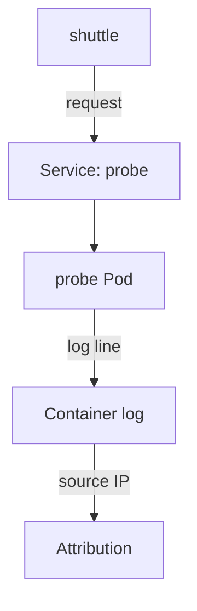

# Network Traffic, Application Logs And Evidence Gaps

By default, Kubernetes does not log the network connections between Pods. If one Pod scans another, the cluster does not record it. The only record may be the log that the receiving application writes. This part follows a request from a client Pod to the `probe` application, matches the log line to the sender, and then lists the ways evidence goes missing. The aim is to make you ask, for every missing record, whether the activity did not happen or the record was never kept.

## Follow one request

Two client Pods exist: `shuttle` in the `starfleet` namespace and `drifter` in the `outpost` namespace. Both are BusyBox containers with `wget`. First select the playground cluster and send a request from `shuttle` to the `probe` Service:

<!-- astrona:playground:renew -->

```sh
export KUBECONFIG="$(astrona kubeconfig ats-036-playground-020-01)"
kubectl -n starfleet exec shuttle -- wget -qO- -T 3 http://probe.starfleet.svc
```

The answer is one line that starts with `version=v1 host=` and ends with `greeting=hello`. The `host` value is the name of the `probe` Pod that answered. A Service chooses one of its ready Pods for each connection.

Send the same request from `drifter`, which is in another namespace:

```sh
kubectl -n outpost exec drifter -- wget -qO- -T 3 http://probe.starfleet.svc
```

It gets the same answer. No NetworkPolicy exists in the playground, so every Pod can reach every other Pod. You can confirm that:

```sh
kubectl get networkpolicy -A
```

The command reports that no resources were found. A NetworkPolicy is a Kubernetes object that limits which Pods may send traffic to which others, but only a network plugin that supports it enforces it.

## Match a log line to the sender

The `probe` web server is a Python program that writes one log line for each request to standard error. Read the last lines of both `probe` Pods:

```sh
kubectl -n starfleet logs -l app=probe --prefix --tail=6
```

Each line has the client IP address, the time, the request line such as `"GET / HTTP/1.1"` and the status `200`. Two kinds of requests appear. The kubelet sends the readiness probe request `GET /ready` every two seconds, so these lines are frequent. The requests that you sent have the path `/`. Now find which Pod owns the client IP address of those lines:

```sh
kubectl get pods -A -o wide
```

The `IP` column contains the address of `shuttle` and of `drifter`. Compare them with the addresses in the log. The line for the first request carries the IP of `shuttle`, and the line for the second request carries the IP of `drifter`. You have attributed each request to a Pod by its address.

This works because Pod-to-Service traffic keeps the source address of the client Pod inside the cluster. It does not work in every path. Traffic that enters through a NodePort, a load balancer or a proxy can show the address of the node or the proxy instead. A Pod IP address is also reused: the Pod that had the address an hour ago may not be the one that has it now. Always record the time with the address.



The diagram shows that the only record of the request is the log line written by the receiving Pod, and the source IP links it to the sender.

## Why evidence goes missing

An empty search result has several possible meanings. The activity did not happen, or the record exists but was lost. Check this list before you conclude anything:

- **The source was never enabled.** The playground has no audit log, no flow logs and no runtime sensor, so there is no record of those events at all.
- **The policy excluded it.** An audit policy with the level `None` for a resource writes nothing about it.
- **The log was rotated.** The kubelet removes old lines when the file reaches its size limit.
- **The Pod is gone.** Deleting a Pod removes its log files from the node.
- **The collector failed.** A node agent that ships logs can stop, and Kubernetes does not report it.
- **The store dropped data.** Sampling, a full disk or a short retention time remove records.
- **The clock was wrong.** A node with a wrong clock puts records in the wrong place in a timeline.

Each cause has the same effect on the investigator: no record. The right statement is "no record found in source X for the period Y", never "nothing happened". Monitor the collection itself. A collector that has sent no logs for an hour is an alert, not a quiet system.

## Sensitive data in logs

Logs can contain tokens, passwords and personal data, for example in a request URL or an error message. Anyone who can read the logs can read this data. Limit access to the log store, avoid writing secrets to standard output, and keep each record only as long as the investigation needs it. You can now say where each layer's evidence is, read the logs of a failing container, link a request to a Pod, and name the gaps in your evidence.

## Common pitfalls

> [!WARNING]
> - **Reading "no log line" as "no request".** The log may have rotated, the Pod may be gone, or the application may not log that path.
> - **Using a Pod IP address without a time.** Addresses are reused after a Pod is replaced.
> - **Assuming the source address is always the client Pod.** NodePort, load balancer and proxy paths can replace it.
> - **Counting readiness probe requests as traffic.** The kubelet sends them on a fixed schedule. Filter them out.
