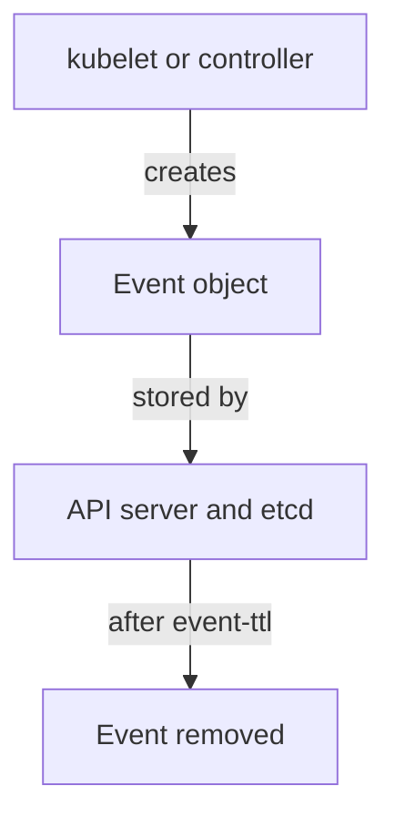

# Kubernetes Events As A Short-Lived Signal

When a Pod is scheduled, an image is pulled or a container fails to start, Kubernetes writes a record about it. These records are events. They are often the quickest way to learn what happened to a workload in the last hour, and they are also the easiest evidence to lose. This part reads the events of a Pod, names the component behind each one, and explains how long they last.

## What an event is

An event is an API object of kind `Event`. A component of the cluster creates it to report that something happened to another object. The scheduler writes `Scheduled` when it picks a node for a Pod. The kubelet, the agent on each node, writes `Pulling`, `Pulled`, `Created` and `Started` while it prepares the containers. A controller, such as the Deployment controller, writes events about the objects it manages.

Every event names the object it is about (`involvedObject`), a short `reason`, a longer `message`, a `type` of `Normal` or `Warning`, and the component that reported it. The reporting component matters in an investigation: a `Warning` from the kubelet describes the node, and a `Warning` from the scheduler describes placement.

Select the playground cluster and read the events of `suspect-pod`:

<!-- astrona:playground:renew -->

```sh
export KUBECONFIG="$(astrona kubeconfig ats-036-playground-020-02)"
kubectl -n starfleet get events --field-selector involvedObject.name=suspect-pod --sort-by=.lastTimestamp
```

The output lists the events in time order, oldest first. A healthy start usually shows `Scheduled`, `Pulled`, `Created` and `Started`, all with type `Normal`. The column `FROM` shows the component that wrote each one. The option `--field-selector` limits the list to one object, and `--sort-by` puts the list in time order, which `kubectl get events` does not do by default.

## Normal events can still matter

All events here have the type `Normal`, yet this Pod is risky. Events report that Kubernetes did its work. They do not judge whether the Pod specification was safe. The cluster admitted a privileged Pod and started it, and it recorded that as a routine start.

Warning events are more useful as an alert: `FailedMount`, `BackOff`, `FailedScheduling`, `Unhealthy` and `Evicted` show a problem. A sudden rise of such events across many Pods can point to a node problem, a bad image or a resource attack. To read all warnings in a namespace, filter on the type:

```sh
kubectl -n starfleet get events --field-selector type=Warning
```

An empty result means that no warning event exists now. It does not mean that none was ever written, as the next section explains.

## How long events last



The API server stores events in etcd with a time to live. The default is one hour, set by the API server flag `--event-ttl`. After that time the event is deleted. Repeated events of the same kind are merged into one object with a `count`, so a long loop can look like a single line.

For this reason events are a view of the recent past, not a log. To keep them, a cluster needs an exporter that reads events from the API and writes them to storage outside the cluster. An investigator who arrives two hours after an incident cannot recover the events from the API.

## What events prove and what they do not

An event proves that a component reported something at a time. It does not prove the cause, and it may be incomplete when the component or the API server was under load. Absence of an event after one hour proves nothing.

You can now read the events of a Pod, name the component behind each one, and explain why they must be collected early. The next question is what the Pod was allowed to do, which the events do not say.

## Common pitfalls

> [!WARNING]
> - **Reading old events as complete.** Events expire after one hour by default.
> - **Treating `Normal` as safe.** A `Normal` event only says that Kubernetes did what the specification asked.
> - **Forgetting the sort order.** `kubectl get events` does not sort by time unless you add `--sort-by=.lastTimestamp`.
> - **Ignoring the `count` field.** One line can stand for many repeated events.
