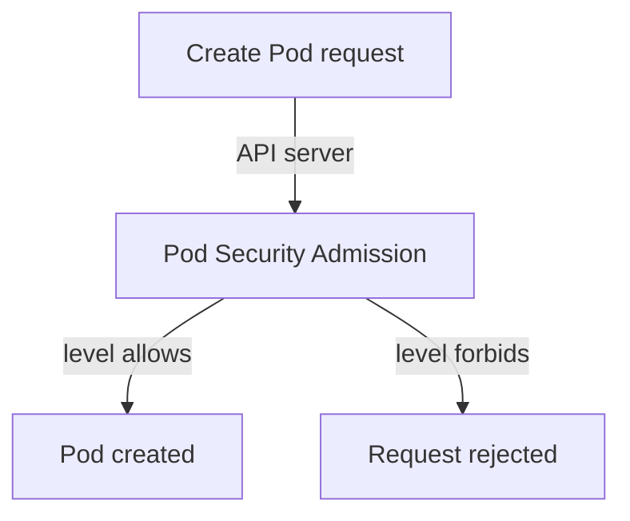

# Reading A Pod Specification For Risky Settings

The Pod specification (`spec`) is the record of what a Pod is allowed to do. A container that runs with extra privileges can act on the node, not only on itself, so the first check on any suspicious workload is to read what it was granted. This part finds two risky settings in `suspect-pod`, shows how to search all namespaces, and explains how Pod Security Admission prevents them.

## Privileged containers and host directories

A container is a Linux process with limited access to the node. Two settings remove that limit.

The setting `securityContext.privileged: true` gives the container almost all capabilities of the node and access to its devices. A process in a privileged container can often mount node disks or load kernel modules, which means it can escape the isolation of the container.

A `hostPath` volume mounts a file or directory from the node into the container. If the path is `/` or `/etc`, a process in the container can read node files, and without `readOnly` it can change them. Other settings in the same group are `hostNetwork`, `hostPID` and `hostIPC`, which share the node namespaces for network, processes and inter-process communication.

Read both settings of `suspect-pod`:

<!-- astrona:playground:renew -->

```sh
export KUBECONFIG="$(astrona kubeconfig ats-036-playground-020-02)"
kubectl -n starfleet get pod suspect-pod -o jsonpath='{.spec.containers[0].securityContext.privileged}{"\n"}'
kubectl -n starfleet get pod suspect-pod -o jsonpath='{.spec.volumes[*].hostPath.path}{"\n"}'
```

The first command prints `true` and the second prints `/etc`. The volume is mounted with `readOnly: true`, which limits writing but not reading. Reading `/etc` of a node can expose its configuration and certificates, so the finding stays.

## Search all namespaces

One Pod is a case. A cluster review needs every Pod. The `custom-columns` output prints one row per Pod with the field you choose:

```sh
kubectl get pods -A -o custom-columns=NAMESPACE:.metadata.namespace,NAME:.metadata.name,PRIVILEGED:.spec.containers[*].securityContext.privileged
```

A value of `true` marks a privileged container, and `<none>` means that the field is not set. Some Pods in `kube-system` can appear with `true`, because components that manage the node may need the right. The question for each row is whether the workload has a reason for it. `suspect-pod` is a BusyBox container that sleeps, so it has none.

The same method finds host mounts. This command prints the Pod name and the host paths of every Pod in the namespace:

```sh
kubectl -n starfleet get pods -o custom-columns=NAME:.metadata.name,HOSTPATH:.spec.volumes[*].hostPath.path
```

Only `suspect-pod` shows `/etc`. Other Pods show `<none>`.

## Pod Security Admission



Pod Security Admission is a built-in admission controller of the API server. It checks each new Pod against a Pod Security Standard level that the namespace selects with a label. The level `privileged` allows everything. The level `baseline` forbids privileged containers and `hostPath` volumes. The level `restricted` adds more rules, for example running as non-root.

The label `pod-security.kubernetes.io/enforce=baseline` on a namespace rejects Pods like `suspect-pod`. The namespace `starfleet` has no such label in this playground, so the API server admitted the Pod. Missing labels are a finding in themselves: they explain why a risky Pod could be created. Admission checks only new Pods, so a Pod created before the label was added keeps running.

You can now read a Pod specification for the settings that matter, find them in every namespace, and name the control that would have rejected them. The Pod specification shows what a workload may do. What it did must come from the application itself.

## Common pitfalls

> [!WARNING]
> - **Judging a Pod by its name or image.** Read `securityContext` and `volumes`.
> - **Reading only `containers`.** `initContainers` and `ephemeralContainers` have their own settings.
> - **Assuming `readOnly: true` makes a host mount safe.** Reading node files can be enough for an attacker.
> - **Expecting a new namespace label to fix running Pods.** Admission does not check Pods that already exist.
