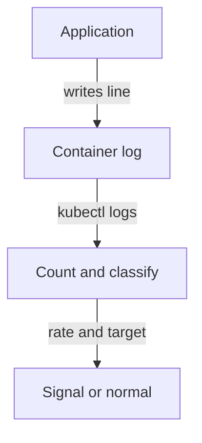

# Application Log Signals Of Abuse

An application knows things that the cluster does not: which user failed to log in, which path returned an error, which request was rejected. These facts appear only in its own log. This part counts failed logins in the `login-service` log, explains how to turn a count into a signal, and states what the log cannot tell you.

## Read and count the log lines

The `login-service` Pod prints one line for every login attempt. The format is `login failed user=admin` or `login ok user=ops`. This command counts the failures:

<!-- astrona:playground:renew -->

```sh
export KUBECONFIG="$(astrona kubeconfig ats-036-playground-020-02)"
kubectl -n starfleet logs login-service | grep -c "login failed"
```

The output is `5`. The option `-c` of `grep` prints the number of matching lines instead of the lines. A second command shows all lines in order:

```sh
kubectl -n starfleet logs login-service
```

Five `login failed user=admin` lines come first, then one `login ok user=ops`. The failures all name the same user, `admin`, and no failure was followed by a success for that user. Count only the lines that match your pattern, and do not count the success line.

## From a count to a signal

A count alone does not mean an attack. A user who mistypes a password produces one or two failures. A signal appears when the count, the time and the target together differ from normal behavior. Five failures for one account within a few seconds suggest automated guessing, called a brute-force attack. One failure on each of many accounts suggests password spraying.

The log has no time on each line, because this application does not write one. The runtime can add the time when it stores the line, and you can read it with `--timestamps`:

```sh
kubectl -n starfleet logs login-service --timestamps
```

Each line now starts with the time the runtime received it. Use these times for the rate of failures. If an application writes its own time, prefer it, but check that the clock is correct. The option `--since=10m` limits the output to a time window so that a count covers a defined period.

## What the log cannot tell you

The `login-service` log does not name the source address of the failed attempts, so you cannot tell whether they came from one client or many. Add the source address to the application log, or take it from a proxy or ingress log. A rate limit or an account lock is a control that stops guessing, and the log shows only that the attempts happened.



The diagram shows the path: the application writes a line, the runtime stores it in the container log, and the investigator counts and classifies it. Each step can lose data. An application that logs nothing leaves nothing to count, and a restart or log rotation removes older lines.

You can now count security-relevant lines, judge them by rate and target, and name what is missing. A workload is fully described by three records: what Kubernetes reported about it, what it was allowed to do, and what it said about itself.

## Common pitfalls

> [!WARNING]
> - **Counting a pattern that is too broad.** `grep -c login` also counts the success line.
> - **Treating a count as an attack.** Compare it with normal behavior for the same time window.
> - **Forgetting the source of the attempts.** Without an address you cannot separate one client from many.
> - **Reading only the current log after a restart.** Use `--previous` for the instance that ended.
