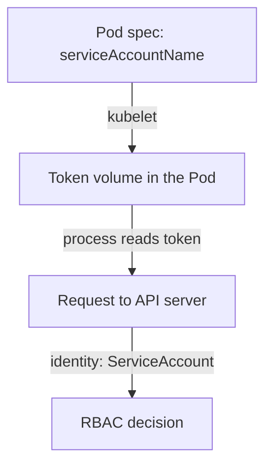

# ServiceAccounts And User Identity

Every request to the Kubernetes API comes from some identity, and an investigation starts by naming it. The audit log, the RBAC rules and the impersonation option all use the same user names. This part explains the two kinds of identity in a cluster, shows how a Pod gets a ServiceAccount token, and finds which account a running Pod uses.

## Two kinds of identity

Kubernetes has no object for a human user. A person is known to the API server by a client certificate, an OpenID Connect token or another authentication method, and the user name comes from that credential. The cluster administrator of a `kind` cluster, for example, uses a client certificate.

A ServiceAccount is the other kind. It is an API object in a namespace that gives a Pod an identity. The API server treats its user name as `system:serviceaccount:<namespace>:<name>`, so the ServiceAccount `reporter` in `starfleet` is `system:serviceaccount:starfleet:reporter`. This full name is what you write in RBAC subjects, impersonation and audit searches.

List the ServiceAccounts of the namespace:

<!-- astrona:playground:renew -->

```sh
export KUBECONFIG="$(astrona kubeconfig ats-036-playground-020-03)"
kubectl -n starfleet get serviceaccounts
```

The list has `default`, `auditor` and `reporter`. Kubernetes creates `default` in every namespace, and a Pod that names no ServiceAccount uses it.

## How a Pod gets a token



When the kubelet starts a Pod, it mounts a projected volume with the token of the Pod's ServiceAccount at `/var/run/secrets/kubernetes.io/serviceaccount`. A process in the container can read the token and send it to the API server as proof of identity. The token is short-lived and bound to the Pod, and the kubelet refreshes it.

Find the account of `data-client` and list the mounted files:

```sh
kubectl -n starfleet get pod data-client -o jsonpath='{.spec.serviceAccountName}{"\n"}'
kubectl -n starfleet exec data-client -- ls /var/run/secrets/kubernetes.io/serviceaccount
```

The first command prints `reporter`. The second lists `ca.crt`, `namespace` and `token`. Anyone who can run commands in this container can read the token and act as `reporter` against the API until the token expires or the Pod ends. That is why the permissions of a ServiceAccount matter as much as the access to the Pod.

## Remove the token when it is not needed

Most application Pods never call the Kubernetes API. The field `automountServiceAccountToken: false` in the Pod specification, or in the ServiceAccount, stops the kubelet from mounting the token. A Pod without the token cannot be used to call the API, so an attacker who gains a shell in it has less to work with.

Check which Pods in the namespace set the field:

```sh
kubectl -n starfleet get pods -o custom-columns=NAME:.metadata.name,SA:.spec.serviceAccountName,AUTOMOUNT:.spec.automountServiceAccountToken
```

The column `AUTOMOUNT` shows `<none>` for every Pod, which means the default applies and the token is mounted. For each Pod with `<none>`, ask whether the application needs the API.

You can now name an identity in the form the API server uses and find out which identity a workload carries. The next question is what that identity is allowed to do.

## Common pitfalls

> [!WARNING]
> - **Using the short name in RBAC checks.** The user name is `system:serviceaccount:<namespace>:<name>`.
> - **Assuming a Pod without a named ServiceAccount has no identity.** It uses `default`.
> - **Searching for human users as API objects.** Kubernetes does not store them.
> - **Ignoring the token inside the Pod.** A shell in the container gives access to the permissions of its ServiceAccount.
