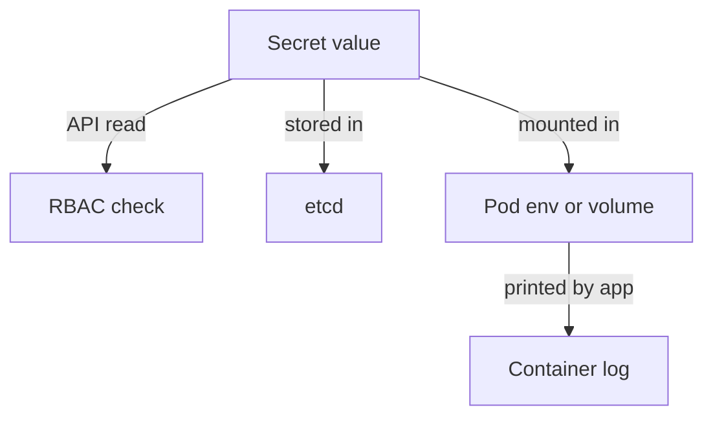

# Secret Exposure Paths

A Secret that no account can read through the API can still be exposed in other ways. The value is stored in etcd, copied into Pods and sometimes printed by accident. Each place is a path an attacker can use, and each has its own control and its own evidence. This part follows the value of `db-credentials` from the API to the environment of a Pod and lists what limits each path.

## The API does not hide the value

A Secret stores its values in base64. Base64 is an encoding, not encryption, and anyone can reverse it. Read the value of `db-credentials` and decode it:

<!-- astrona:playground:renew -->

```sh
export KUBECONFIG="$(astrona kubeconfig ats-036-playground-020-03)"
kubectl -n starfleet get secret db-credentials -o jsonpath='{.data.password}{"\n"}'
kubectl -n starfleet get secret db-credentials -o jsonpath='{.data.password}' | base64 -d
```

The first command prints the encoded value and the second prints the original text, `pass-1234`. The only protection at this point is the RBAC rule that allowed your account to read it.

## Environment variables and volumes

A Pod can receive a Secret value as an environment variable or as a file in a volume. The Pod `data-client` uses the first way. Find the reference in its specification, then read the value from inside the container:

```sh
kubectl -n starfleet get pod data-client -o jsonpath='{.spec.containers[0].env[0].valueFrom.secretKeyRef.name}{"\n"}'
kubectl -n starfleet exec data-client -- printenv DB_PASSWORD
```

The first command prints `db-credentials`. The second prints the decoded value. An environment variable is visible to every process in the container, to anyone who can run `kubectl exec`, and it is often copied into crash dumps, debug output and child processes. A Secret volume holds the value in a file with permissions that you can restrict, and the kubelet updates it when the Secret changes. Files are easier to protect than environment variables, but a user who can run a shell in the container can read them as well.

Find which Pods use a given Secret by searching their specifications:

```sh
kubectl -n starfleet get pods -o custom-columns=NAME:.metadata.name,SECRETENV:.spec.containers[*].env[*].valueFrom.secretKeyRef.name
```

Only `data-client` shows `db-credentials`. The right to run `exec` in that Pod is therefore also a right to read the Secret.

## Other paths



The Secret is stored in etcd. By default etcd holds the values unencrypted, so a copy of an etcd backup or access to the etcd data directory exposes every Secret. The API server can encrypt Secrets before it writes them, which is configured with an `EncryptionConfiguration` file. A Pod that prints its own configuration to standard output copies the value into the container log, and anyone who reads the log reads the value. The kubelet also keeps the data of mounted Secrets in memory on the node, so node access is a path as well.

Each path has a matching control: RBAC for the API, encryption at rest for etcd, restricted `exec` rights and file permissions for the Pod, and a policy of not logging secrets for the log. For detection, the audit log records API reads of Secrets with the user and the time, and the `kubectl exec` request is recorded too.

You can now follow a Secret value through a cluster, name the control for each place and say which evidence would show access. A review that covers the identity, the permissions and the exposure paths has covered who can reach the data and how.

## Common pitfalls

> [!WARNING]
> - **Treating base64 as protection.** Anyone with read access can decode it.
> - **Forgetting `exec`.** The right to run a command in a Pod is a right to read its environment and files.
> - **Printing the value while debugging.** Command output and logs keep the value.
> - **Assuming etcd is encrypted.** It is not unless an `EncryptionConfiguration` is set.
