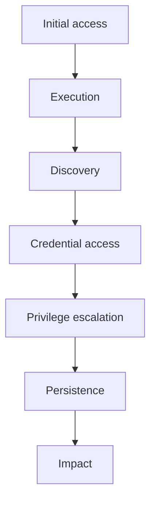

# Attack Phases In Kubernetes

An attack is a series of steps, and each step has a goal. The attacker first needs access, then learns what is there, then gets more authority, then reaches the goal. If you know the phase, you know what to look for next. This part uses the MITRE ATT&CK model, a public list of attacker tactics and techniques, with its container and Kubernetes techniques. It then shows one phase, discovery, from the attacker's side in the playground.

## The phases and what they look like

A tactic is the goal of one phase. The table names the tactics that matter most in a cluster and gives one Kubernetes example of each.

| Phase (tactic) | Goal | Example in Kubernetes |
| --- | --- | --- |
| Initial access | Get a first foothold | An exposed API server or dashboard, a vulnerable application, a stolen kubeconfig, a malicious image |
| Execution | Run code | `kubectl exec` into a container, a new Pod, a CronJob |
| Persistence | Stay after a restart | A backdoor container added to a Deployment template, a CronJob, a new RoleBinding |
| Privilege escalation | Get more authority | A privileged container, a `hostPath` mount, a binding to `cluster-admin` |
| Defense evasion | Avoid detection | Deleting events, clearing container logs, naming a Pod like a system Pod |
| Credential access | Get secrets | Reading Secrets through the API, reading the ServiceAccount token file in the container |
| Discovery | Learn the environment | Listing the permissions of an identity, scanning the network, listing namespaces |
| Lateral movement | Reach other systems | Using a token against other APIs, connecting to other Pods |
| Impact | Reach the goal | Deleting data, using node CPU for mining, denial of service |

The phases are not a fixed order. An attacker may skip phases or repeat them. The value of the model is the vocabulary: an observation gets a phase name, and each phase name suggests the next question.



The diagram shows one common order of phases. A real incident can skip or repeat any of them.

## Discovery seen from the attacker's side

After the first foothold, an attacker with a ServiceAccount token asks the API what that identity may do. You can run the same question with `kubectl auth can-i`, which asks the API server whether an action is allowed. The `--as` option makes the request on behalf of another identity. Select the playground cluster first:

<!-- astrona:playground:renew -->

```sh
export KUBECONFIG="$(astrona kubeconfig ats-036-playground-030-01)"
kubectl config current-context
```

The second line prints `kind-astro-ats-036-playground-030-01`. Now ask about the one action the `threat-client` Pod tried:

```sh
kubectl -n starfleet auth can-i get secrets/audit-token --as=system:serviceaccount:starfleet:threat-reader
```

The answer is `no`. That agrees with the denial that the API server recorded. List everything the identity may do in the namespace:

```sh
kubectl -n starfleet auth can-i --list --as=system:serviceaccount:starfleet:threat-reader
```

The table contains only the entries that Kubernetes gives to every authenticated identity, such as the review resources `selfsubjectaccessreviews` and `selfsubjectrulesreviews` and a few non-resource URLs. It has no row for `secrets`. The ServiceAccount has no RoleBinding, so reading a Secret was never allowed.

## Reading the playground incident as phases

The `threat-client` Pod holds a token and used it to ask for a Secret. In phase terms, this is a credential access attempt. It failed, so it did not reach its goal. The attempt still tells you two things: something in that Pod tried to read Secrets, and the attacker, or the program, knew the name of the Secret.

One event is not a timeline. It does not show how the code got into the Pod, whether other requests came before, or whether another identity succeeded. The next steps of the method answer these questions with more evidence. You now have a vocabulary for phases and a way to test what an identity can do. The next question is who the identity in a record really is.

## Common pitfalls

> [!WARNING]
> - **Treating the phases as a strict sequence.** Attackers skip and repeat phases. Use the model to name observations, not to predict them.
> - **Classifying a failed attempt as no event.** A denied request still shows intent and knowledge, and it can precede a successful request by another identity.
> - **Testing permissions only with your own account.** Use `--as` to test the identity that the attacker used.
> - **Stopping at one event.** A single record is a starting point for a timeline, not a conclusion.
