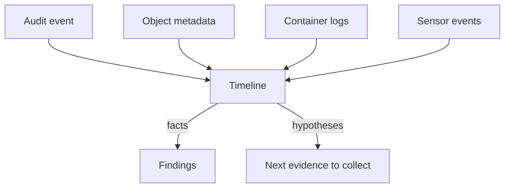

# Building A Timeline From Several Sources

One record shows one moment. An investigation needs the order of many moments, from several sources, to see how an attacker moved. The sources do not share one format, one clock or one set of identifiers. This part lists the sources, reads three of them in the playground, and shows how to keep facts apart from guesses.

## Sources and their keys

Each source answers a different question and has its own key for linking records.

| Source | Answers | Link key |
| --- | --- | --- |
| Kubernetes audit log | Which identity called which API, with what result | `auditID`, `user.username`, `objectRef`, `sourceIPs` |
| Object metadata | When an object was created, who owns it | `creationTimestamp`, `uid`, `ownerReferences` |
| Container logs | What the application printed and when | Pod name, container name, timestamp |
| Runtime sensor events | Which process or file operation happened | Container ID, Pod name, namespace |
| Network and proxy logs | Which source address connected | Source IP address, time |

Times are the weakest key. Audit events carry `requestReceivedTimestamp` and `stageTimestamp` in UTC. Container logs written with `--timestamps` also use UTC. A node whose clock is wrong puts its records in the wrong place. Check that the clocks of the sources agree before you trust the order, and note the difference when they do not.

## Read the audit events in order

The audit log lists events in the order in which the API server wrote them, which is close to, but not exactly, the order of the requests. Print the events of the `starfleet` namespace sorted by time. Select the cluster first:

<!-- astrona:playground:renew -->

```sh
export KUBECONFIG="$(astrona kubeconfig ats-036-playground-030-01)"
node_name="astro-ats-036-playground-030-01-control-plane"
```

Save this as `audit-timeline.py`:

```python
import json
import sys

events = []
for line in sys.stdin:
    line = line.strip()
    if line:
        events.append(json.loads(line))

events.sort(key=lambda event: event.get("stageTimestamp", ""))

for event in events:
    reference = event.get("objectRef", {})
    status = event.get("responseStatus", {})
    print(
        event.get("stageTimestamp"),
        event.get("user", {}).get("username"),
        event.get("verb"),
        reference.get("resource"),
        reference.get("name"),
        status.get("code"),
    )
```

Run it:

```sh
podman exec "$node_name" cat /var/log/training-audit/audit.jsonl | python3 audit-timeline.py
```

Each line is one event, oldest first. Read the user column. You see the identity that created the objects when the playground started, controllers that run as ServiceAccounts in the `kube-system` namespace and create or update Pods, and the `threat-reader` ServiceAccount with the code `403` at the end. The audit policy has the level `Metadata` for Secrets, ConfigMaps and Pods in `starfleet` and `None` for everything else, so the timeline holds only those. A gap in the list may be a policy choice, not an absence of activity.

## Add object metadata

Object metadata gives events that the audit policy does not record. It tells you which controller owns a Pod and when the Pod was created:

```sh
kubectl -n starfleet get pods -l app=probe -o jsonpath='{range .items[*]}{.metadata.name}{" "}{.metadata.creationTimestamp}{" "}{.metadata.ownerReferences[0].kind}{"/"}{.metadata.ownerReferences[0].name}{"\n"}{end}'
```

Each line has the Pod name, its creation time and its owner, which is a `ReplicaSet`. A ReplicaSet is the controller object that keeps a set number of identical Pods running. The ReplicaSet in turn has an owner:

```sh
kubectl -n starfleet get replicaset -o jsonpath='{range .items[*]}{.metadata.name}{" "}{.metadata.ownerReferences[0].kind}{"/"}{.metadata.ownerReferences[0].name}{"\n"}{end}'
```

The owner is `Deployment/probe`. This chain, Pod to ReplicaSet to Deployment, tells you which template recreates a Pod. The `threat-client` Pod has no owner. You can check it with the same field:

```sh
kubectl -n starfleet get pod threat-client -o jsonpath='{.metadata.ownerReferences}{"\n"}{.metadata.creationTimestamp}{"\n"}'
```

The first line is empty, because nothing owns the Pod, and nothing will recreate it if it is deleted. The second line is when the Pod was created. The denied request must be later than this time. If an audit event were earlier than the Pod's creation time, the record would belong to another object or the clocks would disagree.

## Separate fact from hypothesis

Write the timeline in two columns. A fact is something a record directly shows. A hypothesis is a statement that you infer. For this playground:

- Fact: at the time in the audit event, the identity `system:serviceaccount:starfleet:threat-reader` sent `get` for `secrets/audit-token` and received `403`.
- Fact: the Pod `threat-client` has no owner reference and uses that ServiceAccount.
- Hypothesis: a process in `threat-client` sent the request. The source address supports it, and a runtime sensor event would confirm it.
- Hypothesis: the same process will try other Secrets. No record of this exists yet.



The diagram shows that all sources feed one timeline, and the timeline yields findings and a list of evidence that is still missing. You can now order events and mark what is proven. The last question is what to do with a confirmed incident.

## Common pitfalls

> [!WARNING]
> - **Sorting by the order of lines in a file.** Sort by timestamp, and check the clocks.
> - **Reading a policy gap as a quiet period.** The audit policy decides what is recorded. Events at the level `None` are absent.
> - **Mixing local time and UTC.** Convert everything to UTC before you merge sources.
> - **Writing hypotheses as facts.** Mark each line as a fact or a hypothesis, and write what record supports it.
