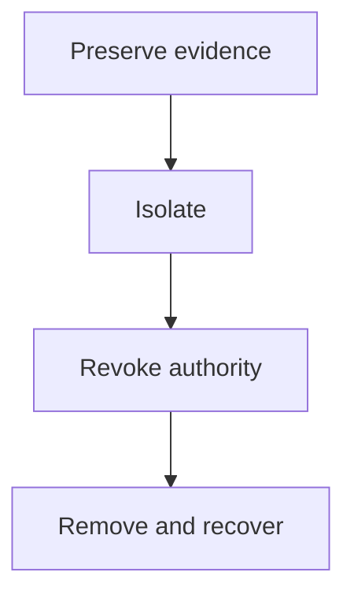

# Containment And Evidence Preservation

When a Pod is compromised, the first reaction is to delete it. Deleting it removes the process list, the temporary files and the container log, and it leaves the cause in place: the Deployment that created the Pod still has the same template, and the ServiceAccount still has the same permissions. This part gives an order of steps that keeps the evidence, stops the spread and removes the attacker's authority, and it tests in the playground what deleting does and does not remove.

## The order of steps

Containment has four steps. The order matters because each step can destroy information that the earlier steps need.

1. **Preserve.** Save the Pod object, its logs, and any state that disappears with the Pod.
2. **Isolate.** Stop traffic to and from the Pod without deleting it, for example by changing the labels that a Service selects, or with a NetworkPolicy.
3. **Revoke.** Remove the authority the attacker held: the ServiceAccount permissions, the tokens, and the Secrets that the identity could read.
4. **Remove and recover.** Delete the compromised objects, fix the template or image that created them, and start clean Pods.



The diagram shows that removal is the last step, after the evidence is saved and the authority is revoked.

For a very fast attack, you may isolate before you preserve. That choice is acceptable when you note it in the record. The point is that deletion is not the first action.

## Preserve

Select the cluster and save what the Pod object and its log hold:

<!-- astrona:playground:renew -->

```sh
export KUBECONFIG="$(astrona kubeconfig ats-036-playground-030-01)"
kubectl -n starfleet get pod threat-client -o yaml > threat-client-evidence.yaml
kubectl -n starfleet logs threat-client --timestamps > threat-client-logs.txt
```

The YAML file contains the image and its digest, the ServiceAccount, the node, the start time and the container status. The log file is empty here, because the `threat-client` container only sleeps. The request program is started by `kubectl exec`, and its output goes to the terminal of the command, not to the container log. This is an example of a limit: a process started by `exec` does not write to `kubectl logs`.

## Find what recreates a Pod

Test the claim that deleting a Pod removes the problem. Delete one `probe` Pod and list the Pods again:

```sh
suspect_pod="$(kubectl -n starfleet get pods -l app=probe -o jsonpath='{.items[0].metadata.name}')"
kubectl -n starfleet delete pod "$suspect_pod"
kubectl -n starfleet get pods -l app=probe
```

The listing shows two `probe` Pods. One of them has a new name and an age of a few seconds. The ReplicaSet created it from the same template within moments. If the template had contained a malicious container or a changed image, the new Pod would carry it too. To stop a compromised workload from returning, change or scale the controller after you have preserved the evidence.

The Pod `threat-client` is different. No controller owns it, so deleting it ends it for good. A bare Pod is easier to remove, but the evidence disappears with it, so preserve first.

## Revoke authority

The identity can outlive the Pod. What happens to a token depends on how it was made:

- A token that Kubernetes projected into the Pod is bound to that Pod. When the Pod is deleted, the API server stops accepting the token.
- A token created with `kubectl create token` is bound to the ServiceAccount and has an expiry time. It stays valid until it expires or until the ServiceAccount is deleted.
- A long-lived token stored in a Secret of the type `kubernetes.io/service-account-token` is valid until the Secret or the ServiceAccount is deleted.

To revoke an identity, remove its RoleBindings and ClusterRoleBindings and delete the ServiceAccount or its token Secrets. Then rotate every secret value that the identity could read, because a read that succeeded earlier cannot be undone. Look for authority that the attacker may have added for persistence:

```sh
kubectl -n starfleet get rolebindings,cronjobs,jobs
kubectl get clusterrolebindings --sort-by=.metadata.creationTimestamp
```

The first command should list nothing the playground did not create. In this playground it reports that no resources were found. The second command lists ClusterRoleBindings with the newest last. In a real cluster, check the newest entries and any entry that you cannot explain, because a new binding to a powerful role is a common persistence step.

## Remove and recover

After the evidence is saved and the authority is revoked, remove the compromised objects and recreate them from a trusted source: a reviewed manifest, an image referenced by digest, and a new ServiceAccount with the least permissions that the workload needs. Then watch the new Pods with the same detection that found the first one. A containment is confirmed only when the suspicious activity stops, not when the command succeeds.

## Common pitfalls

> [!WARNING]
> - **Deleting a controlled Pod and calling it contained.** The ReplicaSet creates a new Pod from the same template.
> - **Deleting before preserving.** Process state, temporary files and logs are lost with the Pod.
> - **Revoking only the Pod.** Tokens made with `kubectl create token` and token Secrets outlive the Pod.
> - **Forgetting data the identity could read.** Rotate those secrets even when you found no read.
