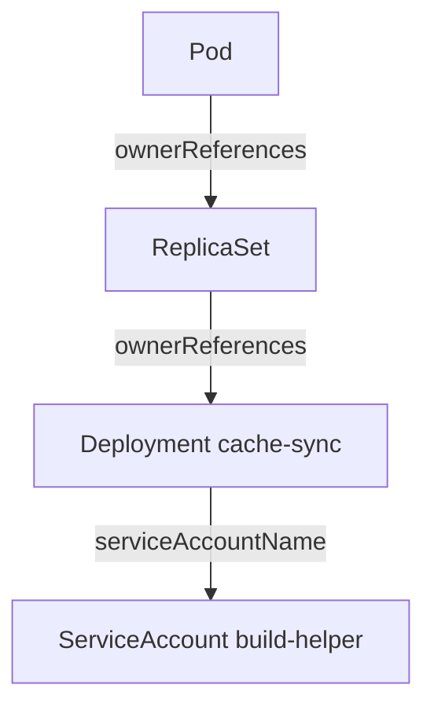

# Persistence In Workload Templates And Schedules

Removing a Pod rarely removes an attacker who has write access to the API. A Pod is the result of a template, and the attacker can change the template. This part lists the objects that restart code, shows how to find the one behind a running Pod, and explains why the owner matters more than the Pod.

## Objects that keep code running

Persistence means that the attacker's code or access survives the removal of the first foothold. The table lists the objects that do this in a cluster.

| Object | How it persists |
| --- | --- |
| Deployment, StatefulSet, DaemonSet | The controller creates a new Pod from its template whenever a Pod stops |
| CronJob | The CronJob controller creates a Job on a schedule, so code runs again even after the Pod is gone |
| RoleBinding, ClusterRoleBinding | The binding keeps the permissions of an identity, so a new Pod can use them |
| Secret of type `kubernetes.io/service-account-token` | A long-lived token that works from outside the cluster until the Secret is deleted |
| Static Pod manifest on a node | The kubelet (the node agent) starts the Pod from a file on the node, with no API object to delete |

Most of these exist as API objects, so a search of the API finds them. A static Pod manifest exists only on the node. The kubelet shows it in the API as a read-only mirror Pod, and deleting the mirror Pod does not stop it.

## Follow the owner of a Pod

Every Pod that a controller creates carries `ownerReferences` in its metadata. The field names the object that created it. Select the playground cluster and find the owner of the `cache-sync` Pod:

<!-- astrona:playground:renew -->

```sh
export KUBECONFIG="$(astrona kubeconfig ats-036-playground-030-02)"
kubectl config current-context
kubectl -n starfleet get pods -l app=cache-sync
```

The second command prints `kind-astro-ats-036-playground-030-02`. Read the owner of the Pod:

```sh
kubectl -n starfleet get pods -l app=cache-sync -o jsonpath='{.items[0].metadata.ownerReferences[0].kind}{" "}{.items[0].metadata.ownerReferences[0].name}{"\n"}'
```

The owner is a ReplicaSet. A ReplicaSet is the object that keeps a fixed number of identical Pods. The ReplicaSet has its own owner, so ask the same question about it:

```sh
replica_set="$(kubectl -n starfleet get pods -l app=cache-sync -o jsonpath='{.items[0].metadata.ownerReferences[0].name}')"
kubectl -n starfleet get replicaset "$replica_set" -o jsonpath='{.metadata.ownerReferences[0].kind}{" "}{.metadata.ownerReferences[0].name}{"\n"}'
```



The diagram shows the chain from the visible Pod up to the Deployment, and the identity the template gives to every Pod.

## What the template tells you

The Deployment is the object to preserve and to stop. Its template contains the image, the command, the environment variables and the ServiceAccount that every new Pod gets. Read it:

```sh
kubectl -n starfleet get deployment cache-sync -o yaml
```

Check `spec.template.spec.serviceAccountName`, the `image`, the `command` and the `env` list. Then check `metadata.creationTimestamp` and `metadata.managedFields`, which record when the object appeared and which client wrote it. A Deployment that no one in the team can explain, created at an odd time, is a strong finding.

Search the whole cluster for objects of the same kind, sorted by age:

```sh
kubectl get deployments,daemonsets,statefulsets,cronjobs -A --sort-by=.metadata.creationTimestamp
```

The newest objects appear last. Compare them with what the team expects. An attacker with enough authority can also hide in `kube-system`, so search all namespaces and not only the one with the alert.

## Why the Pod is the wrong target

Delete the Pod and list again to see the effect:

```sh
kubectl -n starfleet delete pod -l app=cache-sync
kubectl -n starfleet get pods -l app=cache-sync
```

The listing shows a Pod with a different name and a very young age. The ReplicaSet created it from the same template, with the same image and the same ServiceAccount. Deleting the Pod also removed its container log and its process state. You lost evidence and the attacker lost nothing.

You now know how to find the object that keeps code running. The next question is what authority that code holds, and who gave it.

## Common pitfalls

> [!WARNING]
> - **Deleting the Pod first.** The controller starts a replacement, and the evidence in the first Pod is gone.
> - **Searching only one namespace.** Persistence objects can be in any namespace, including `kube-system`.
> - **Ignoring CronJobs.** A CronJob can restart code on a schedule even when no Deployment exists.
> - **Trusting the Pod name.** Names come from the controller and say nothing about who created the controller.
