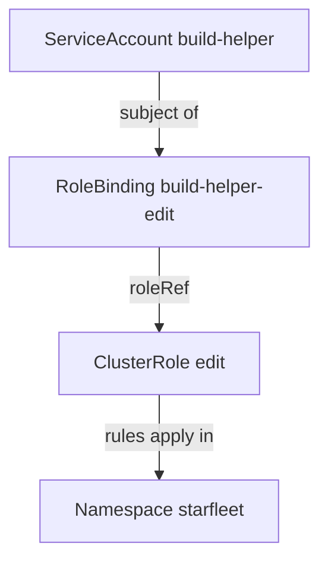

# Privilege Escalation Through Bindings And Pod Settings

Persistent code is only dangerous in proportion to its authority. Authority in Kubernetes comes from RBAC (role-based access control) bindings and from settings in the Pod specification. This part finds the binding behind a ServiceAccount, tests what it allows, names the settings and verbs that raise authority, and ends with a containment in the playground.

## From a ServiceAccount to its permissions

A ServiceAccount has no permissions by itself. A RoleBinding connects it to a Role or ClusterRole, and the rules of that role then apply inside the namespace of the binding. List the bindings of the namespace with their subjects:

<!-- astrona:playground:renew -->

```sh
export KUBECONFIG="$(astrona kubeconfig ats-036-playground-030-02)"
kubectl -n starfleet get rolebindings -o wide
```

The columns `ROLE` and `SERVICEACCOUNTS` show which role each binding gives to which ServiceAccount. One binding names the `build-helper` ServiceAccount that the `cache-sync` Deployment uses. Read it in full:

```sh
kubectl -n starfleet get rolebinding build-helper-edit -o yaml
```

The `roleRef` points to the ClusterRole `edit`. A RoleBinding that references a ClusterRole grants the rules of that ClusterRole only inside the namespace of the RoleBinding. The ClusterRole `edit` allows reading and changing most namespaced objects, including Secrets, Pods and Deployments.



The diagram shows how the identity reaches its permissions, and that the namespace of the binding limits them.

## Test what the identity can do

Do not guess from the role name. Ask the API server what the identity may do, with `--as` to act on behalf of the ServiceAccount:

```sh
kubectl -n starfleet auth can-i --list --as=system:serviceaccount:starfleet:build-helper
kubectl -n starfleet auth can-i get secrets --as=system:serviceaccount:starfleet:build-helper
kubectl -n starfleet auth can-i create rolebindings --as=system:serviceaccount:starfleet:build-helper
```

Compare the answers with the identity that has the normal binding, `probe-reader`, using the same commands with `--as=system:serviceaccount:starfleet:probe-reader`. The `edit` role reads Secrets and creates Pods, and the `view` role does not. The role `edit` does not allow creating RoleBindings, so this identity cannot give itself more authority through RBAC.

## What raises authority

Four groups of permissions and settings turn a small foothold into a large one.

- **RBAC verbs that change RBAC.** The verbs `escalate`, `bind` and `impersonate`, and the right to create RoleBindings or ClusterRoleBindings, let an identity grant or use more than it has.
- **Creating Pods.** An identity that can create Pods can mount any Secret or ServiceAccount of the namespace in a new Pod and read it.
- **Pod specification settings.** `privileged: true`, `hostPID`, `hostNetwork` and `hostPath` volumes give a container access to the node.
- **Tokens.** The right to create tokens for a ServiceAccount (`serviceaccounts/token`) gives the credentials of that ServiceAccount to the caller.

Search the namespace for Pods that use the node-level settings:

```sh
kubectl get pods -A -o custom-columns=NAMESPACE:.metadata.namespace,NAME:.metadata.name,PRIVILEGED:.spec.containers[*].securityContext.privileged,HOSTPID:.spec.hostPID,HOSTNETWORK:.spec.hostNetwork
```

Pods of the cluster components in `kube-system` set some of these fields legitimately. A `<none>` value means the field is not set. The `cache-sync` Pod sets none of them, so its authority comes only from the binding.

## Contain in a safe order

The persistence and the authority are two separate objects, so contain both. Preserve first, because deleting objects removes the evidence of who created them:

```sh
kubectl -n starfleet get deployment cache-sync -o yaml > cache-sync-deployment.yaml
kubectl -n starfleet get rolebinding build-helper-edit -o yaml > build-helper-edit-binding.yaml
kubectl -n starfleet logs -l app=cache-sync --timestamps > cache-sync-logs.txt
```

Then stop the persistence without deleting the Deployment. Scaling to zero removes the Pods and keeps the object for the record. Remove the binding to end the authority:

```sh
kubectl -n starfleet scale deployment/cache-sync --replicas=0
kubectl -n starfleet delete rolebinding build-helper-edit
```

Check the result with `kubectl -n starfleet get pods,rolebindings`. The `cache-sync` Pod is gone or terminating and no replacement appears. The binding `probe-reader-view` still exists, because it belongs to normal operation. Authorization is checked on every request, so a token that the attacker copied no longer works for anything the binding allowed. Secrets that the identity could read still need to be rotated.

You now know how to find and remove both halves of a persistent foothold. The graded task on the next page asks you to do this in a fresh cluster and record the finding.

## Common pitfalls

> [!WARNING]
> - **Removing only the binding or only the Deployment.** Without the binding the code runs with little authority, and without the Deployment the authority waits for the next workload. Remove both.
> - **Deleting the Deployment before saving it.** The template is the best evidence of what the attacker ran.
> - **Judging a role by its name.** Test with `kubectl auth can-i --as`.
> - **Removing the normal binding too.** Delete only the binding that you tied to the incident.
