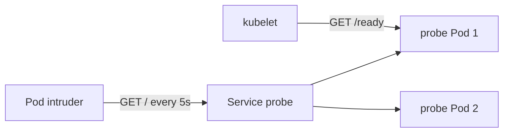

# Lateral Movement And Network Evidence

Lateral movement is the phase in which an attacker uses one compromised workload to reach others. The first Pod is rarely the target. This part starts from the target, reads who connected to it, maps the address in the log to a Pod and explains how much that mapping proves.

## What lateral movement looks like

The attacker's Pod connects to a Service or Pod it has no reason to use. In a cluster without NetworkPolicy, every Pod can reach every other Pod, so the network does not stop it. The evidence is on the receiving side. An HTTP server such as the `probe` application writes one access log line per request, and the line starts with the address of the client.

Other sources help when they exist. The audit log shows requests to the Kubernetes API only, not traffic between Pods. A service mesh or a network flow log shows connections, but this playground has neither. The access log of the target is the evidence you have.

## Read the access log of the target

Select the playground cluster and print the last lines of the log of both `probe` Pods:

<!-- astrona:playground:renew -->

```sh
export KUBECONFIG="$(astrona kubeconfig ats-036-playground-030-03)"
kubectl -n starfleet logs -l app=probe --prefix --tail=10
```

The `--prefix` option starts each line with the name of the Pod that wrote it. Each log line has the client address first, then the request. Count the requests per client address across both Pods:

```sh
kubectl -n starfleet logs -l app=probe --tail=-1 | awk '{print $1}' | sort | uniq -c
```

The result lists each client address with the number of requests. At least two kinds of client appear. The kubelet, the node agent, sends the readiness probe request to `/ready` every two seconds, and its address belongs to the node network. The other address sends a request every five seconds to `/`.

## Map the address to a Pod

An IP address is not a name. Print every Pod with its IP address and the node it runs on:

```sh
kubectl get pods -A -o wide
```

Find the address that sends the regular requests in the column `IP`. Replace `<SOURCE_IP>` with that address and search for it:

```sh
kubectl get pods -A -o wide | grep -F "<SOURCE_IP>"
```

The line shows the namespace and name of the Pod that owns the address. The Pod `intruder` in the namespace `outpost` is the client. The kubelet address matches no Pod, because the kubelet runs on the node and not in a Pod.



The diagram shows that the intruder reaches whichever `probe` Pod the Service selects, and that the kubelet probes each Pod directly.

## How much the mapping proves

The mapping is strong when the Pod still exists and its address was not reused. Pod addresses are reused when Pods are replaced, so a log line from last week may point to a different Pod today. Compare the time of the log line with the `creationTimestamp` of the Pod. A Service changes the destination of a request but usually not its source, so the client address in the log is normally the address of the client Pod. A proxy, a load balancer or a node-level translation can change the source, and then the log shows the proxy.

The log also shows only what reached the application. A missing line is not proof that no connection happened. The application may log only some requests, the logs may have rotated, or the traffic may have used another port. Write what the log shows as a fact, and write the conclusion about the attacker as a hypothesis.

You have traced one connection to its source. The next part looks for the effects an attacker causes once they have reached their target.

## Common pitfalls

> [!WARNING]
> - **Treating every unusual address as an attacker.** The kubelet, monitoring agents and health checks produce regular requests. Identify them first.
> - **Using an old address.** Pod IP addresses are reused. Check the age of the Pod against the time of the log line.
> - **Reading a missing line as safety.** Logs have gaps. Say what is not covered.
> - **Reading only one Pod.** A Service sends requests to several Pods, so each Pod log holds a part of the traffic.
