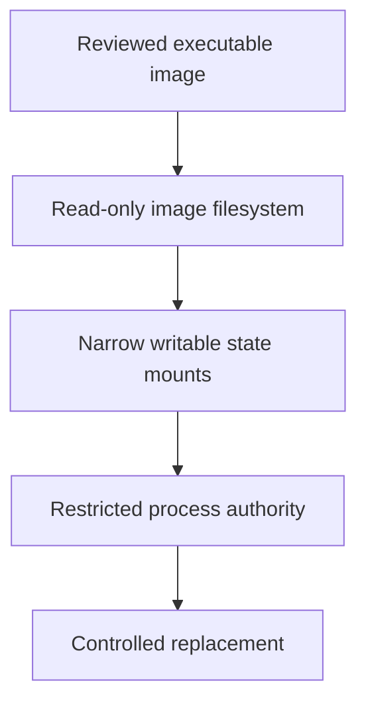

# Constraining Runtime Mutation And Writable Paths

An application needs temporary files but does not need to rewrite its executable directory. A narrow writable volume can preserve its function while the image filesystem remains read-only.

## Learning objectives

- Explain read-only root filesystems and their limits.
- Separate required temporary data from executable image content.
- Relate capabilities, identity and host mounts to immutability.

## Before you start

This chapter is standalone reading material; no running cluster or installed tools are required. A Pod is the Kubernetes unit for running one or more containers, and a namespace groups namespaced objects. Treat the worked configurations as teaching examples rather than recorded observations from a provisioned environment.

## Responsible components and behavior

An immutable deployment model updates software by replacing a reviewed artifact rather than modifying a running container. This makes the relationship between deployed image, configuration and observed behavior easier to understand. Runtime immutability adds restrictions on unnecessary changes, but the application still needs carefully defined writable data and authority.

## Separate Image Content From State

The image supplies executable code and supporting files. Application state, temporary files and caches can have different lifetimes and should use appropriate volumes or external systems. If a process writes package updates or new executables into its own image filesystem during ordinary operation, the running state can diverge from the reviewed artifact.

Kubernetes provides readOnlyRootFilesystem in the container security context. It restricts writes to the root filesystem for that container. It does not automatically make every separately mounted volume read-only. A writable temporary volume can remain available at a defined path while the executable image content stays protected. Review each container independently rather than assume one setting covers all auxiliary containers.

## Design Necessary Writable Paths

Suppose an application writes transient request files under a temporary directory. A narrow ephemeral volume at that path can satisfy the requirement without making the whole root writable. Persistent business data belongs under an explicitly selected storage contract, with ownership and recovery appropriate to the data. The process's user and permissions must permit the intended writes without broad host authority.

Writable paths can still become execution surfaces if the application loads scripts, plugins or binaries from them. A compromised process may use such paths to change future behavior even when the root is read-only. Evaluate how the application treats the writable data, not merely whether the path is outside the image root. Mount options and runtime policy can contribute further restrictions where supported.

## Combine Runtime Boundaries

Running as an appropriate non-root identity, removing unnecessary capabilities and disallowing privilege escalation narrow available authority. Seccomp and mandatory access controls can restrict operations further. Privileged containers or writable host mounts can undermine an immutability design by granting authority outside the intended application filesystem.

A read-only root does not make supplied credentials harmless. An attacker may read an accessible token and use it against an external service, or modify data in a permitted volume. Memory-only execution and malicious use of existing binaries can also avoid installing new files. Immutability is one boundary within a broader execution, identity and network design.

## Favor Reviewed Replacement

When a library or application needs an update, rebuild and verify the image, then replace the workload through the supported rollout process. Installing a package interactively inside a running container produces an untracked state that is lost on replacement and may differ between replicas. It also weakens the link between build evidence and actual execution.

Replacement is not a complete recovery procedure if credentials were stolen or external data was changed. Review controller templates, mounted configuration and persistent volumes as well as image bytes. A new container can consume the same compromised configuration or credential if those dependencies remain unchanged.

## Interpret Runtime Changes

Unexpected writes to executable paths or changes inconsistent with the deployment model can support detection. Record the expected writable surfaces so a legitimate cache update is not confused with code mutation. A denied write may reveal either an application compatibility issue or malicious activity; correlate the process and intended operation before changing policy. Keep the correction as narrow as the demonstrated requirement.

## Work through the decision

An immutable delivery model changes software through reviewed replacement rather than ad hoc edits to running image content. A read-only root filesystem constrains image writes, but separately mounted volumes can remain writable. Inspect each container and mount rather than assuming one setting protects every path.

Writable paths can still hold scripts or plugins that an application executes. Minimal capabilities, suitable identity, system-call restrictions and controlled loading behavior therefore remain relevant. A host runtime socket or broad API credential can also enable changes outside the container's filesystem. Explain the constrained behavior and remaining authority instead of treating filesystem immutability as a complete compromise boundary.

Runtime immutability separates necessary state writes from software mutation while preserving other required controls.

Runtime immutability separates necessary state writes from software mutation while preserving other required controls.

## Common pitfalls

> [!WARNING]
> A read-only root does not freeze writable mounts or prevent credential misuse. Immutability requires deliberate writable paths and replacement policy alongside identity, capability and host-access controls.
