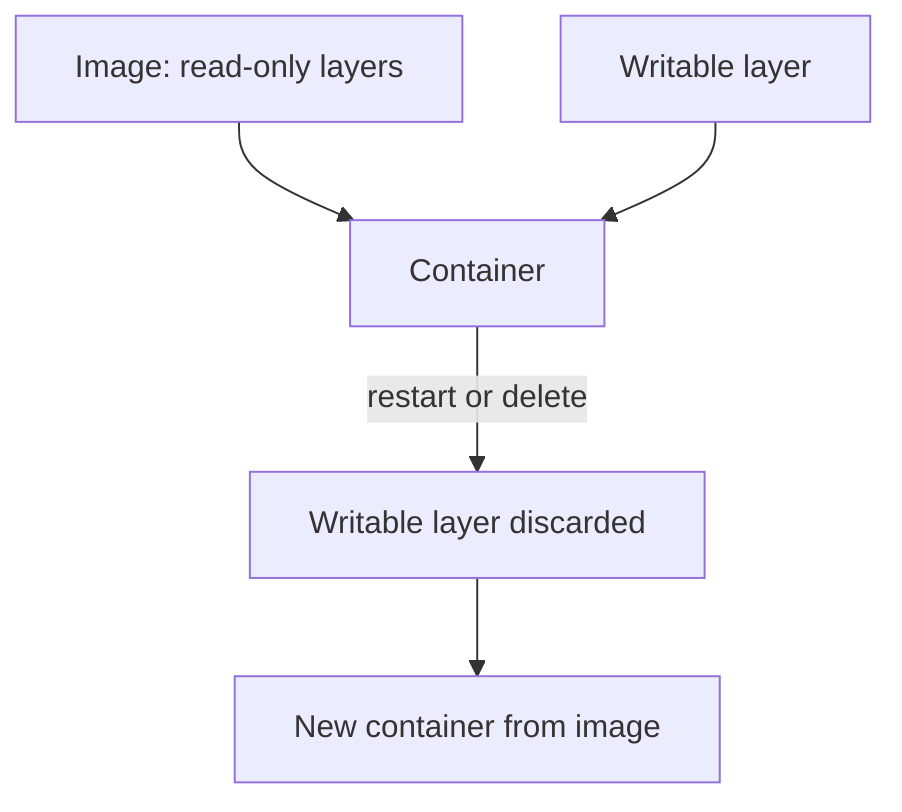

# The Writable Container Layer

A container image is a stack of read-only layers. When a container starts, the container runtime adds one writable layer on top. Everything the process writes goes there, unless a volume is mounted at that path. This part shows what a process can change in that layer in the playground, what happens to the changes when the container is replaced, and why that supports the rule: replace a container, never patch it.

## Image layers and the writable layer

The container runtime builds the root filesystem of a container from the image layers, using a union filesystem such as overlayfs. The image layers stay unchanged. When a process changes a file from the image, the runtime copies the file into the writable layer first. This is copy on write. The writable layer belongs to one container instance. When the container is removed or restarted, the runtime creates a fresh layer, and the old changes are gone.

The writable layer is a risk for two reasons. An attacker with code execution can add a program and run it. An administrator can also fix a problem by hand inside a running container, and nobody records the change. Both leave the running container different from the image that was reviewed.

## Mutate a running container

Select the playground cluster and pick one `probe` Pod. The second line prints the Pod name:

<!-- astrona:playground:renew -->

```sh
export KUBECONFIG="$(astrona kubeconfig ats-036-playground-040-01)"
probe_pod="$(kubectl -n starfleet get pods -l app=probe -o jsonpath='{.items[0].metadata.name}')"
echo "$probe_pod"
```

Now write a new executable file into the container and run it:

```sh
kubectl -n starfleet exec "$probe_pod" -- sh -c 'printf "#!/bin/sh\necho added-at-runtime\n" > /usr/local/bin/tool.sh && chmod +x /usr/local/bin/tool.sh && /usr/local/bin/tool.sh'
```

The output is `added-at-runtime`. The root filesystem of the container accepted a new program in a system directory, and the process ran it. Nothing in the Pod specification blocked this. The container runs as root and its root filesystem is writable, which are the defaults.

Check that the change is only in this container instance. Delete the Pod and read the new one:

```sh
kubectl -n starfleet delete pod "$probe_pod"
new_pod="$(kubectl -n starfleet get pods -l app=probe -o jsonpath='{.items[0].metadata.name}')"
kubectl -n starfleet exec "$new_pod" -- ls /usr/local/bin/tool.sh
```

The last command fails with the message `No such file or directory`. The ReplicaSet created a new Pod from the image, and the image does not contain `tool.sh`. Wait until the new Pod is `Running` if the command reports that the container is not ready, and run it again. This is the principle of immutable infrastructure: a changed container is replaced by a new one built from the image, and the manual change disappears.

## Image identity

Replacing a container only restores the reviewed state if the image is the reviewed image. A tag such as `3.13-alpine` can be moved to a different image later. A digest is the SHA-256 hash of the image content, and it cannot point to different content. The running container reports the digest it was started from:

```sh
kubectl -n starfleet get pod "$new_pod" -o jsonpath='{.status.containerStatuses[0].imageID}{"\n"}'
```

The value has the form `docker.io/library/python@sha256:` followed by 64 hexadecimal characters. In a Pod specification, write the image as `name@sha256:<digest>` to pin it. A pinned image gives the same content on every node and every restart.



The diagram shows that the image stays unchanged and the writable layer is discarded when the container is replaced.

## Why writable by default is a problem

A writable root filesystem allows many attack steps. An attacker can download and run a tool, change an application file, add a shell, or drop a script that a later process reads. Detection tools can watch for such writes, but prevention is stronger: if the root filesystem is read-only, these writes fail. The next part sets that up and keeps the application working.

## Common pitfalls

> [!WARNING]
> - **Patching a running container by hand.** The change is lost on restart and nobody reviewed it. Change the image or the Pod template instead.
> - **Pinning only a tag.** A tag can point to different content later. Use the digest.
> - **Assuming a restart removes an attacker.** A restart removes changes in the writable layer, but not changes on a volume, and not a compromised Pod template.
> - **Believing the image is checked at run time.** Kubernetes does not compare the running filesystem with the image. Prevention and detection have to be set up.
