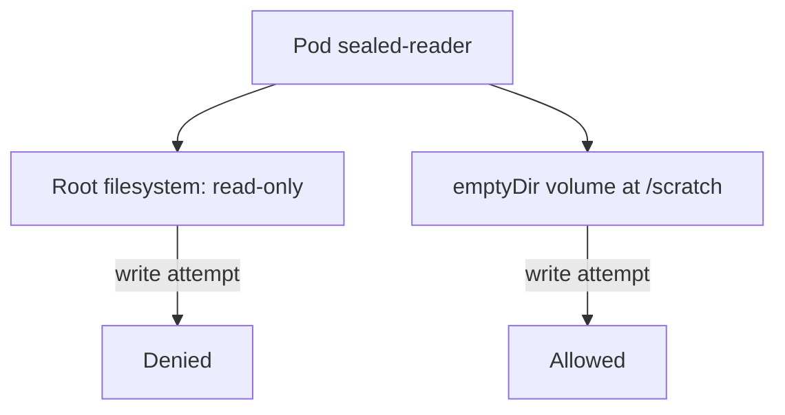

# Read-Only Root Filesystem And Security Context

The previous part showed that a default container accepts a new program anywhere in its filesystem. This part builds a Pod that rejects such writes. The setting is `readOnlyRootFilesystem`, and it works together with a non-root user, dropped capabilities and a seccomp profile. Applications still need some writable paths, so you also add a small `emptyDir` volume.

## What each setting does

All settings below live in the `securityContext` of the Pod or of the container. The container level overrides the Pod level for the same field.

| Setting | Level | Effect |
| --- | --- | --- |
| `readOnlyRootFilesystem: true` | container | The root filesystem is mounted read-only. Writes outside volumes fail. |
| `runAsNonRoot: true` | Pod or container | The kubelet refuses to start a container whose user is root. |
| `runAsUser`, `runAsGroup` | Pod or container | Numeric user and group of the container process. |
| `allowPrivilegeEscalation: false` | container | Sets the `no_new_privs` flag. A process cannot gain more privileges than its parent, for example through a set-user-ID binary. |
| `capabilities.drop: ["ALL"]` | container | Removes all Linux capabilities. |
| `seccompProfile.type: RuntimeDefault` | Pod or container | Filters system calls with the default profile of the container runtime. |
| `fsGroup` | Pod | Gives the Pod group ownership of supported volumes, so a non-root user can write to them. |

A read-only root filesystem blocks the write step of an attack. A non-root user with no capabilities and no privilege escalation limits what the process can do even if it finds a writable path.

## Why an application still needs a writable path

Many programs write temporary files, sockets, caches or process identifiers. If the root filesystem is read-only, those programs fail at start, often with an error that contains `Read-only file system`. The fix is not to make the root filesystem writable. The fix is to mount a volume at exactly the paths that need writes. An `emptyDir` volume is created empty when the Pod starts and removed when the Pod is deleted. It is a good scratch space for temporary data.



The diagram shows the two filesystem areas of the Pod and which one accepts writes.

## Build the sealed Pod

Select the playground cluster and check that the `shuttle` Pod uses the BusyBox image that the new Pod will use:

<!-- astrona:playground:renew -->

```sh
export KUBECONFIG="$(astrona kubeconfig ats-036-playground-040-01)"
kubectl config current-context
kubectl -n starfleet get pod shuttle -o jsonpath='{.spec.containers[0].image}{"\n"}'
```

Save this as `sealed-reader.yaml`:

```yaml
apiVersion: v1
kind: Pod
metadata:
  name: sealed-reader
  namespace: starfleet
spec:
  securityContext:
    runAsNonRoot: true
    runAsUser: 10001
    runAsGroup: 10001
    fsGroup: 10001
    seccompProfile:
      type: RuntimeDefault
  containers:
    - name: reader
      image: docker.io/library/busybox:1.37.0
      command: ["sleep", "3600"]
      securityContext:
        readOnlyRootFilesystem: true
        allowPrivilegeEscalation: false
        capabilities:
          drop: ["ALL"]
      volumeMounts:
        - name: scratch
          mountPath: /scratch
  volumes:
    - name: scratch
      emptyDir:
        sizeLimit: 16Mi
```

Apply it:

```sh
kubectl apply -f sealed-reader.yaml
```

Then wait for the Pod:

```sh
kubectl -n starfleet wait --for=condition=Ready pod/sealed-reader --timeout=90s
```

## Then check the result

Try a write to the root filesystem and a write to the scratch volume:

```sh
kubectl -n starfleet exec sealed-reader -- sh -c 'echo test > /root-file'
kubectl -n starfleet exec sealed-reader -- sh -c 'echo test > /scratch/file && cat /scratch/file'
```

The first command fails with a message that ends in `Read-only file system`, and `kubectl` returns a non-zero exit status. The second command succeeds and prints `test`. Check the user of the process and the capability set:

```sh
kubectl -n starfleet exec sealed-reader -- id
kubectl -n starfleet exec sealed-reader -- grep -E 'CapEff|NoNewPrivs' /proc/1/status
```

The `id` output shows user and group `10001`. The effective capability set `CapEff` is all zeros, and `NoNewPrivs` is `1`.

Confirm that the settings are in the stored Pod object:

```sh
kubectl -n starfleet get pod sealed-reader -o jsonpath='{.spec.containers[0].securityContext}{"\n"}'
```

The JSON shows `readOnlyRootFilesystem` as `true`, `allowPrivilegeEscalation` as `false` and the dropped capability list.

## Fields are not changed on a running Pod

Most security context fields cannot be edited on a running Pod. To change them, edit the Deployment or Pod template and let Kubernetes create a replacement. This is the same replace-not-patch rule from the previous part.

## Common pitfalls

> [!WARNING]
> - **Setting only `readOnlyRootFilesystem`.** A root user with extra capabilities can still do damage through other paths. Combine it with a non-root user, dropped capabilities and `allowPrivilegeEscalation: false`.
> - **Forgetting the writable path.** The application then fails at start. Find the paths it writes, and mount an `emptyDir` volume there. Do not turn off the read-only setting.
> - **Mounting a volume over a system directory.** A volume hides the image content in that directory. Mount at specific data paths.
> - **Using a name for `runAsUser`.** The field takes a number. With `runAsNonRoot: true`, an image whose user is a name and not a number cannot be verified, so set `runAsUser` explicitly.
> - **Expecting `fsGroup` to fix every volume.** It applies to volume types that support ownership management. Check the owner of the mounted path when a write fails.
