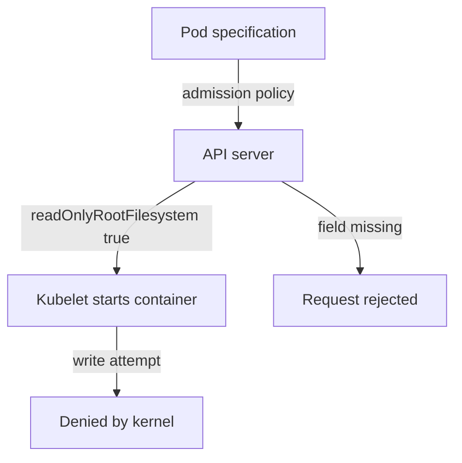

# Verifying And Enforcing Immutability

Setting `readOnlyRootFilesystem` in one Pod protects one Pod. A cluster has many Pods, written by many people, and any of them can leave the setting out. This part shows how to find Pods that are still mutable, how to block them at admission with a ValidatingAdmissionPolicy, and how to limit the two ways an operator or attacker can still change a running container: `exec` access and a changed image.

## Find mutable Pods

The stored Pod object holds the answer, so `kubectl` can list it for every Pod. A field that is not set shows as `<none>`, which means the root filesystem is writable.

<!-- astrona:playground:renew -->

```sh
export KUBECONFIG="$(astrona kubeconfig ats-036-playground-040-01)"
kubectl config current-context
kubectl get pods -A -o custom-columns='NAMESPACE:.metadata.namespace,NAME:.metadata.name,READONLY:.spec.containers[0].securityContext.readOnlyRootFilesystem'
```

The `probe`, `shuttle` and `drifter` Pods show `<none>`. If you created the Pods from the earlier parts, `sealed-reader` shows `true`, while `compliant-pod` shows `<none>` because it passed Pod Security Admission without the field. System Pods in `kube-system` show `<none>` or `true` depending on the component. Only the first container is listed, so a Pod with sidecars needs a closer check.

## Enforce the field with a ValidatingAdmissionPolicy

A ValidatingAdmissionPolicy is a built-in admission rule written in the Common Expression Language (CEL). The API server evaluates the expression for each matching request and rejects the request when the expression is false. No webhook server is needed. It is stable in Kubernetes 1.35 under `admissionregistration.k8s.io/v1`.

A policy needs two objects: the policy that holds the rule, and a binding that says where it applies and what happens on a violation. Save this as `policy-readonly-root.yaml`:

```yaml
apiVersion: admissionregistration.k8s.io/v1
kind: ValidatingAdmissionPolicy
metadata:
  name: require-readonly-root
spec:
  failurePolicy: Fail
  matchConstraints:
    resourceRules:
      - apiGroups: [""]
        apiVersions: ["v1"]
        operations: ["CREATE", "UPDATE"]
        resources: ["pods"]
  validations:
    - expression: "object.spec.containers.all(c, has(c.securityContext) && has(c.securityContext.readOnlyRootFilesystem) && c.securityContext.readOnlyRootFilesystem)"
      message: "Every container must set readOnlyRootFilesystem to true."
```

Save this as `binding-readonly-root.yaml`. It applies the policy to the `sealed` namespace only:

```yaml
apiVersion: admissionregistration.k8s.io/v1
kind: ValidatingAdmissionPolicyBinding
metadata:
  name: require-readonly-root-sealed
spec:
  policyName: require-readonly-root
  validationActions: ["Deny"]
  matchResources:
    namespaceSelector:
      matchLabels:
        kubernetes.io/metadata.name: sealed
```

Apply both:

```sh
kubectl apply -f policy-readonly-root.yaml
kubectl apply -f binding-readonly-root.yaml
```

The `validationActions` field decides the effect. `Deny` rejects the request, `Warn` returns a warning to the client and `Audit` adds an audit annotation. As with Pod Security Admission, you can start with `Warn` and `Audit` and switch to `Deny` when the existing workloads comply.

## Then check the result

This check uses the `sealed` namespace. If it does not exist, create it with `kubectl create namespace sealed`. Save a Pod that passes the `restricted` standard but leaves the root filesystem writable as `writable-pod.yaml`:

```yaml
apiVersion: v1
kind: Pod
metadata:
  name: writable-pod
  namespace: sealed
spec:
  securityContext:
    runAsNonRoot: true
    runAsUser: 10001
    seccompProfile:
      type: RuntimeDefault
  containers:
    - name: main
      image: docker.io/library/busybox:1.37.0
      command: ["sleep", "3600"]
      securityContext:
        allowPrivilegeEscalation: false
        capabilities:
          drop: ["ALL"]
```

Apply it:

```sh
kubectl apply -f writable-pod.yaml
```

The API server rejects the Pod. The error names the policy `require-readonly-root` and shows the message `Every container must set readOnlyRootFilesystem to true.` If the Pod is accepted, the binding is not active yet. Wait a few seconds and apply the file again. Add `readOnlyRootFilesystem: true` to the container `securityContext` and apply the file again to see the Pod accepted.

## Limit who can run commands in a container

A read-only root filesystem still lets a user with `exec` rights read data and write to mounted volumes. In RBAC, `exec` is the subresource `pods/exec` with the verb `create`. The verb `get` on `pods` does not include it. Check what a ServiceAccount can do:

```sh
kubectl auth can-i create pods/exec -n starfleet --as=system:serviceaccount:outpost:default
```

The default ServiceAccount has no Role, so the answer is `no`. Grant `pods/exec` only to the people who need it for incident response, and record the use of it in the audit log, where it appears as a request on the `exec` subresource.

## Check that the image did not change

Immutability also means the running image is the reviewed image. Compare the image reference in the Pod specification with the digest the node reports:

```sh
kubectl -n starfleet get pods -l app=probe -o jsonpath='{range .items[*]}{.metadata.name}{" "}{.spec.containers[0].image}{" "}{.status.containerStatuses[0].imageID}{"\n"}{end}'
```

Each line has the Pod name, the image tag from the specification and the `imageID` with the `sha256` digest. All replicas of a Deployment should show the same digest. A different digest for the same tag means the tag moved between pulls. To detect writes at run time, a tool such as Falco watches system calls and raises an alert when a process writes a file below a binary directory such as `/usr/bin`. This is reading-only here, because Falco is not installed in the playground.



The diagram shows two checks: the policy at admission and the read-only mount at run time.

Together, the controls make a container that cannot change its own code. The image is fixed by digest, the root filesystem refuses writes, a policy rejects Pods that omit the setting, and only a few people can run commands inside. The open question for incident response is what to do when an attacker still uses a writable volume, which is where runtime detection and audit logs complete the picture.

## Common pitfalls

> [!WARNING]
> - **Enforcing in all namespaces at once.** System components may fail to start. Scope the binding with a `namespaceSelector`, and start with `Warn`.
> - **Checking only the first container.** Sidecars and init containers need the field too. The CEL expression above covers `containers`; add `initContainers` when you need them.
> - **Granting `pods/exec` through a wildcard.** A rule with `resources: ["*"]` includes `pods/exec`. Name the resources.
> - **Trusting the tag.** Compare digests, and deploy by digest.
> - **Fixing a rejected Pod by turning the policy off.** Fix the Pod specification instead.
