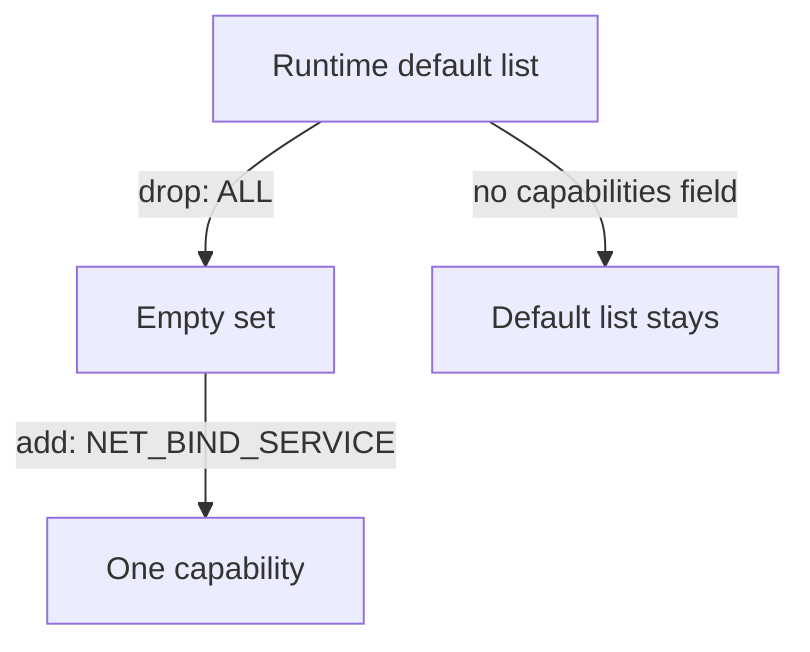

# Linux Capabilities And What A Container Starts With

A container process that runs as root does not need all the power of the root user on a Linux host. Linux splits the power of root into separate units called capabilities. A capability is one named right, such as the right to change file ownership or to open a raw network socket. This part shows which capabilities a container gets by default, why several of them matter for security, and how to remove all of them.

## The capability sets of a process

The Linux kernel keeps several capability sets for each process. Two of them matter here. The bounding set is the upper limit: a process can never hold a capability that is not in it. The effective set holds the capabilities the kernel checks when the process makes a privileged request. Both appear as hexadecimal numbers in `/proc/<pid>/status`, in the lines `CapBnd` and `CapEff`. A value of all zeros means the process holds no capability.

The container runtime sets these sets when it starts the container. Without a `capabilities` setting in the Pod, the runtime gives the container a default list. The default list of containerd and CRI-O includes these capabilities:

| Capability | What it allows | Risk |
| --- | --- | --- |
| `CHOWN` | Change the owner of any file | Take over files that belong to other users |
| `DAC_OVERRIDE` | Skip file read, write and execute permission checks | Read or change any file the container can see |
| `FOWNER` | Skip checks that need the file owner to match | Change permissions on files of other users |
| `SETUID`, `SETGID` | Change the user and group of the process | Switch to another identity inside the container |
| `SETPCAP` | Change the capability sets of the process | Pass rights on to other processes |
| `NET_RAW` | Open raw and packet sockets | Send forged network packets, for example ARP or ICMP |
| `NET_BIND_SERVICE` | Listen on ports below 1024 | Low risk, and often the only one an application needs |
| `KILL` | Send signals to processes of other users | Stop other processes in the container |
| `SYS_CHROOT` | Call `chroot` | Change the apparent root directory of a process |
| `MKNOD` | Create device files | Create a device node |

Some capabilities are not in the default list because they are far more dangerous. `SYS_ADMIN` allows mounts and many other administrative actions. `SYS_PTRACE` allows reading the memory of other processes. `NET_ADMIN` allows changing network interfaces and firewall rules. A Pod that adds one of these asks for a large part of the power of the node.

## Read the capabilities of a default container

Select the playground cluster:

<!-- astrona:playground:renew -->

```sh
export KUBECONFIG="$(astrona kubeconfig ats-036-playground-040-02)"
kubectl config current-context
```

Save this as `cap-default.yaml`:

```yaml
apiVersion: v1
kind: Pod
metadata:
  name: cap-default
  namespace: starfleet
spec:
  containers:
    - name: worker
      image: docker.io/library/busybox:1.37.0
      command: ["sleep", "3600"]
```

Apply it:

```sh
kubectl apply -f cap-default.yaml
```

Then wait for the Pod and read its capability sets:

```sh
kubectl -n starfleet wait --for=condition=Ready pod/cap-default --timeout=90s
kubectl -n starfleet exec cap-default -- grep -E 'CapBnd|CapEff' /proc/1/status
```

Process 1 of the container is the `sleep` command, which runs as root. Both lines show a non-zero value, which is the default capability list as a bit mask. The Pod did not ask for any capability. The runtime added them.

## Drop all capabilities

The `capabilities` field of the container `securityContext` has two lists, `drop` and `add`. The runtime applies `drop` to the default list first and then applies `add`. The value `ALL` in `drop` removes every capability. Save this as `cap-dropped.yaml`:

```yaml
apiVersion: v1
kind: Pod
metadata:
  name: cap-dropped
  namespace: starfleet
spec:
  containers:
    - name: worker
      image: docker.io/library/busybox:1.37.0
      command: ["sleep", "3600"]
      securityContext:
        capabilities:
          drop: ["ALL"]
```

Apply it and read the same two lines:

```sh
kubectl apply -f cap-dropped.yaml
kubectl -n starfleet wait --for=condition=Ready pod/cap-dropped --timeout=90s
kubectl -n starfleet exec cap-dropped -- grep -E 'CapBnd|CapEff' /proc/1/status
```

Both values are now all zeros. The container still runs as root, but the root user holds no capability, so the privileged requests of that table fail. Test one of them. Changing the owner of a file needs `CHOWN`:

```sh
kubectl -n starfleet exec cap-default -- sh -c 'touch /tmp/owned && chown 1234 /tmp/owned && echo changed'
kubectl -n starfleet exec cap-dropped -- sh -c 'touch /tmp/owned && chown 1234 /tmp/owned && echo changed'
```

The first command prints `changed`. The second command fails with an `Operation not permitted` error and returns a non-zero exit status, because the process no longer has `CHOWN`.



The diagram shows the order: the runtime starts from its default list, applies `drop`, and then applies `add`.

## What to add back

Most applications need no capability at all. Start with `drop: ["ALL"]` and add back one capability only when the application fails with a clear `Operation not permitted` error. The usual case is `NET_BIND_SERVICE` for a server on a port below 1024. A better answer is to listen on a port above 1023, because a Service can map port 80 to any container port.

This part showed what a container starts with and how one setting removes it. A root process with no capabilities is much weaker, but it is still root, and a root process can still do some things that need no capability, such as using files that root owns. The next part removes root as well.

## Common pitfalls

> [!WARNING]
> - **Dropping capabilities at the Pod level.** The `capabilities` field exists only in the container `securityContext`. Putting it under the Pod `securityContext` is rejected.
> - **Writing lowercase or prefixed names.** The Kubernetes field uses the name without the `CAP_` prefix, for example `NET_BIND_SERVICE`.
> - **Adding `SYS_ADMIN` to fix an error.** This hands the container most of the power of the node. Find the one capability the error names, or change the application.
> - **Reading only `CapEff`.** The bounding set `CapBnd` shows the upper limit. A process with an empty bounding set can never gain a capability later.
> - **Expecting a dropped capability to protect files.** Capabilities limit privileged requests. They do not make a file read-only.
