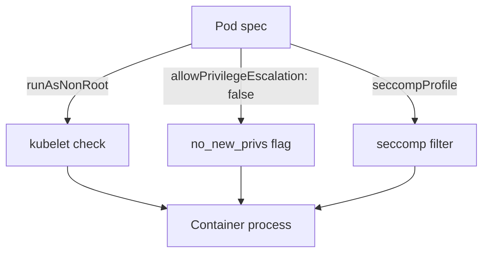

# Non-Root Identity And Privilege Escalation

Dropping capabilities removes what root can do, but the user ID of the process still decides which files it can read and write. A process that runs as a normal user with no capabilities has very little power. This part shows how Kubernetes makes sure a container runs as a non-root user, and how the `no_new_privs` flag stops that process from becoming more powerful by running another program.

## Run as a specific user

Linux identifies users by number. The root user is user ID 0. The `runAsUser` and `runAsGroup` fields set the numeric user and group of the container process. They override the user in the image. The `runAsNonRoot: true` field is a check, not a setting: the kubelet looks at the user the container would run as, and it refuses to start the container if that user is root.

The check needs a number. If the image names its user with a name such as `app`, and the Pod does not set `runAsUser`, the kubelet cannot prove the user is not root, and it refuses to start the container too. Always set `runAsUser` together with `runAsNonRoot`.

## See the refusal

The BusyBox image runs as root. Save this as `root-refused.yaml`:

<!-- astrona:playground:renew -->

```yaml
apiVersion: v1
kind: Pod
metadata:
  name: root-refused
  namespace: starfleet
spec:
  securityContext:
    runAsNonRoot: true
  containers:
    - name: worker
      image: docker.io/library/busybox:1.37.0
      command: ["sleep", "3600"]
```

Apply it and look at the Pod:

```sh
kubectl apply -f root-refused.yaml
kubectl -n starfleet get pod root-refused
```

The Pod does not become ready. Its status is `CreateContainerConfigError`, and the events explain the reason:

```sh
kubectl -n starfleet describe pod root-refused
```

The event message says that the container has `runAsNonRoot` and the image will run as root. The kubelet, not the application, produced this error, and no container process ever started. Delete the Pod before you continue:

```sh
kubectl -n starfleet delete pod root-refused
```

## Set the user

Save this as `non-root.yaml`. It sets the numeric user and group, and it also drops all capabilities:

```yaml
apiVersion: v1
kind: Pod
metadata:
  name: non-root
  namespace: starfleet
spec:
  securityContext:
    runAsNonRoot: true
    runAsUser: 2000
    runAsGroup: 2000
  containers:
    - name: worker
      image: docker.io/library/busybox:1.37.0
      command: ["sleep", "3600"]
      securityContext:
        capabilities:
          drop: ["ALL"]
```

Apply it and check the identity:

```sh
kubectl apply -f non-root.yaml
kubectl -n starfleet wait --for=condition=Ready pod/non-root --timeout=90s
kubectl -n starfleet exec non-root -- id
```

The output shows user ID 2000 and group ID 2000. The container runs because the numeric user is not zero.

## Privilege escalation and no_new_privs

A set-user-ID program runs with the privileges of the file owner, not of the user who starts it. If a root-owned set-user-ID binary exists in the image, a normal user can run it and become root inside the container. The kernel flag `no_new_privs` stops this. When a process has the flag, no program it starts can gain more privileges than the process already has, and the set-user-ID bit has no effect.

Kubernetes sets the flag with `allowPrivilegeEscalation: false` in the container `securityContext`. The default of this field is true, except when the container is privileged or has the `SYS_ADMIN` capability. In those two cases the field is always true. Add the setting to the Pod and read the flag. Save this as `no-escalation.yaml`:

```yaml
apiVersion: v1
kind: Pod
metadata:
  name: no-escalation
  namespace: starfleet
spec:
  securityContext:
    runAsNonRoot: true
    runAsUser: 2000
    runAsGroup: 2000
    seccompProfile:
      type: RuntimeDefault
  containers:
    - name: worker
      image: docker.io/library/busybox:1.37.0
      command: ["sleep", "3600"]
      securityContext:
        allowPrivilegeEscalation: false
        capabilities:
          drop: ["ALL"]
```

Apply it and compare the `no_new_privs` flag of the two Pods:

```sh
kubectl apply -f no-escalation.yaml
kubectl -n starfleet wait --for=condition=Ready pod/no-escalation --timeout=90s
kubectl -n starfleet exec non-root -- grep NoNewPrivs /proc/1/status
kubectl -n starfleet exec no-escalation -- grep NoNewPrivs /proc/1/status
```

The `non-root` Pod shows `NoNewPrivs` as `0`, and the `no-escalation` Pod shows `1`. The second Pod also has a seccomp profile. Read it from the same file:

```sh
kubectl -n starfleet exec no-escalation -- grep Seccomp /proc/1/status
```

The line `Seccomp` shows `2`, which means the process runs with a seccomp filter. A seccomp filter is a list of system calls the kernel allows, and `RuntimeDefault` selects the default list of the container runtime. The default list blocks system calls that containers almost never need, which reduces the kernel attack surface.



The diagram shows that the kubelet checks the user before start, while the runtime applies the flag and the filter to the process.

This part gave the process a normal identity and closed the set-user-ID path. The remaining question is what happens when a Pod asks for more than the defaults, and how to find such Pods before they run.

## Common pitfalls

> [!WARNING]
> - **Using `runAsNonRoot` without a numeric user.** An image that names its user cannot be verified, and the container will not start. Set `runAsUser`.
> - **Trusting the image user.** An image can change its user in a new version. The Pod setting makes the requirement explicit.
> - **Assuming `allowPrivilegeEscalation: false` removes capabilities.** It sets `no_new_privs` only. Drop the capabilities separately.
> - **Setting the field on a privileged container.** A privileged container always allows privilege escalation, so Kubernetes rejects the combination.
> - **Forgetting the group.** A non-root user may fail to write to a volume because of its group. Set `runAsGroup` and `fsGroup` for volumes that must be writable.
