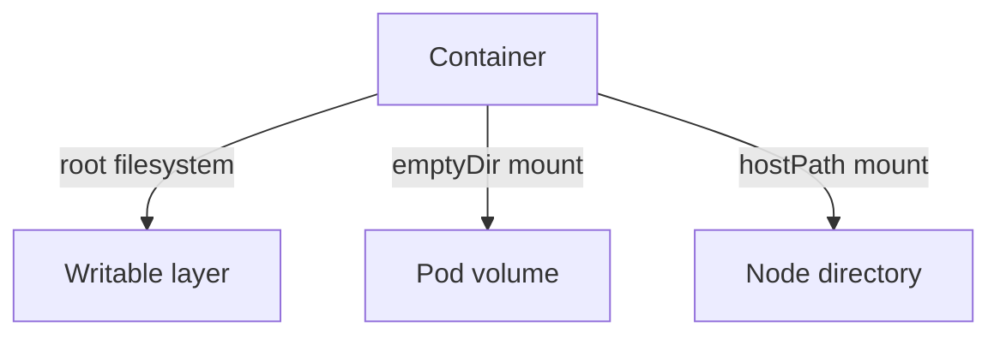

# Volumes That Reach The Host

A read-only root filesystem protects the files of the image. A volume is a different filesystem, and a volume of type `hostPath` is a directory of the node itself. This part shows what a `hostPath` volume gives to a container, why that breaks the idea of an immutable container, and how a read-only volume mount limits the damage when such a volume cannot be avoided.

## What hostPath gives

A `hostPath` volume mounts a file or directory from the filesystem of the node into the container. The container then reads and writes real node files. The `type` field checks what the path is: `Directory` requires an existing directory, `DirectoryOrCreate` creates it if it is missing, `File` requires an existing file and `Socket` requires a Unix socket.

The risk depends on the path. A directory such as `/var/log` exposes logs of other Pods. The directory `/etc` exposes node configuration. The Unix socket of the container runtime, for example `/run/containerd/containerd.sock`, lets the container start new containers on the node, including privileged ones. The kubelet directory `/var/lib/kubelet` holds the tokens and secrets of every Pod on the node. A writable mount of any of these gives a path from one compromised container to the whole node.

The `baseline` and `restricted` Pod Security Standards both forbid `hostPath` volumes. Many monitoring and logging agents still need one. If a `hostPath` is unavoidable, the Pod should mount the narrowest possible path and mount it read-only.

## Write through a hostPath volume

Select the playground cluster:

<!-- astrona:playground:renew -->

```sh
export KUBECONFIG="$(astrona kubeconfig ats-036-playground-040-03)"
kubectl config current-context
```

Save this as `host-writer.yaml`:

```yaml
apiVersion: v1
kind: Pod
metadata:
  name: host-writer
  namespace: starfleet
spec:
  containers:
    - name: worker
      image: docker.io/library/busybox:1.37.0
      command: ["sleep", "3600"]
      volumeMounts:
        - name: node-logs
          mountPath: /node-logs
  volumes:
    - name: node-logs
      hostPath:
        path: /var/log
        type: Directory
```

Apply it and write a file through the mount:

```sh
kubectl apply -f host-writer.yaml
kubectl -n starfleet wait --for=condition=Ready pod/host-writer --timeout=90s
kubectl -n starfleet exec host-writer -- sh -c 'echo written-by-pod > /node-logs/pod-write-test && cat /node-logs/pod-write-test'
```

The command prints `written-by-pod`. The file now exists in `/var/log` on the node, outside the container filesystem. The container image and the root filesystem setting played no part in this write, because the mount is a different filesystem.



The diagram shows three places a container can write: its own layer, a volume that lives and ends with the Pod, and a directory of the node that keeps the data.

## Mount it read-only

The `readOnly: true` field of a `volumeMount` makes that mount read-only for the container. Save this as `host-reader.yaml`:

```yaml
apiVersion: v1
kind: Pod
metadata:
  name: host-reader
  namespace: starfleet
spec:
  containers:
    - name: worker
      image: docker.io/library/busybox:1.37.0
      command: ["sleep", "3600"]
      volumeMounts:
        - name: node-logs
          mountPath: /node-logs
          readOnly: true
  volumes:
    - name: node-logs
      hostPath:
        path: /var/log
        type: Directory
```

Apply it, read the file that the first Pod wrote and then try to write:

```sh
kubectl apply -f host-reader.yaml
kubectl -n starfleet wait --for=condition=Ready pod/host-reader --timeout=90s
kubectl -n starfleet exec host-reader -- cat /node-logs/pod-write-test
kubectl -n starfleet exec host-reader -- sh -c 'echo changed > /node-logs/pod-write-test'
```

The read prints `written-by-pod`. The write fails with an error that ends in `Read-only file system`. The read-only mount keeps the data readable and removes the write. A log collector needs nothing more.

Clean up the test file by deleting it from the first Pod:

```sh
kubectl -n starfleet exec host-writer -- rm /node-logs/pod-write-test
```

This part showed that the filesystem setting covers only the root filesystem, and that every writable volume needs its own decision. The next part moves from where a container writes to how a container changes over time.

## Common pitfalls

> [!WARNING]
> - **Treating `hostPath` as storage.** It ties the Pod to one node and exposes that node. Use a PersistentVolumeClaim for application data.
> - **Mounting a parent directory.** A mount of `/` or `/var` exposes far more than the application needs. Mount the narrowest path.
> - **Mounting the runtime socket.** Access to the container runtime socket is access to every container on the node.
> - **Setting `readOnly` on the volume source only.** Set `readOnly: true` on the `volumeMount` of each container that must not write.
> - **Forgetting `emptyDir`.** Applications that write temporary files need a Pod volume, not a node path.
