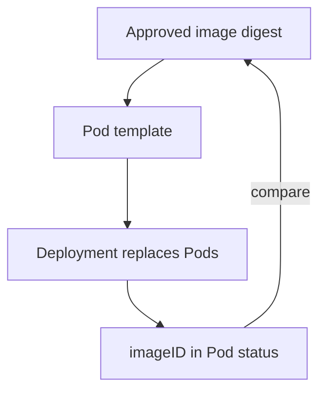

# Pinning Images And Detecting Drift

A replacement is only as trustworthy as the image it starts from. An image tag such as `python:3.13-alpine` is a name that the registry owner can point to a different image tomorrow. This part explains tags and digests, shows how to read which image a container actually runs, and describes how to find workloads that differ from what you approved.

## Tags and digests

A tag is a movable label on an image in a registry. The image behind `python:3.13-alpine` changes whenever the maintainers publish a new build. A digest is the SHA-256 hash of the image manifest. The same digest always refers to exactly the same content. An image reference with a digest has the form `repository/name@sha256:<64 hexadecimal characters>`.

The Pod template can hold a tag, a digest or both. When it holds a digest, the container runtime pulls exactly that image and checks the hash. A changed tag in the registry cannot change what runs. The cost is that you update the digest on purpose when you want a new build, which is the replacement path of a Deployment rollout.

The field `imagePullPolicy` decides when the kubelet pulls. With `Always`, the kubelet asks the registry on each container start. With `IfNotPresent`, it uses an image that is already on the node. With a tag but no digest, two nodes can run different images under the same tag if they pulled at different times.

## Read what runs

The Pod template says what was requested. The Pod status says what the runtime started. In the Pod status, `imageID` holds the digest of the image that the container uses. Print both for the `probe` Pods:

<!-- astrona:playground:renew -->

```sh
export KUBECONFIG="$(astrona kubeconfig ats-036-playground-040-03)"
kubectl -n starfleet get pods -l app=probe -o jsonpath='{range .items[*]}{.metadata.name}{"\t"}{.spec.containers[0].image}{"\t"}{.status.containerStatuses[0].imageID}{"\n"}{end}'
```

Each line shows a Pod name, the image reference from the template and the `imageID`, which ends in a `sha256:` digest. The playground uses a tag. Both Pods should show the same digest. A different digest in one Pod would mean that two nodes pulled different builds under the same tag.

## Compare against an approved list

A simple drift check compares the `imageID` of every Pod in a namespace to a list of approved digests that you keep in version control. Print a sorted list of the distinct digests that run in `starfleet`:

```sh
kubectl -n starfleet get pods -o jsonpath='{range .items[*]}{.status.containerStatuses[*].imageID}{"\n"}{end}' | sort -u
```

Every line in the output must appear on the approved list. A line that is not on the list means a Pod runs an image that nobody approved. The check does not tell you why, so the next step is to look at the Pod's owner and its events.

## Detect drift in the definition

The running Pods can also differ from the file in the repository. The command `kubectl diff` compares a local file with the live object and prints the changes that an apply would make. Save the live Deployment to a file and compare it to itself to see the empty result of a matching object:

```sh
kubectl -n starfleet get deployment probe -o yaml > probe-live.yaml
kubectl diff -f probe-live.yaml
```

Before you read the output, note that `kubectl diff` needs the file to be a valid object. The two objects here match, so the diff shows little or nothing apart from server-managed fields. In a real workflow, the file comes from version control. A diff that shows a changed image, a removed `securityContext` field or a new volume means someone changed the cluster by hand.

## Enforce the approved image

Detection finds a problem after the fact. Admission can block it. A ValidatingAdmissionPolicy can require that every container image contains `@sha256:`, which rejects tag-only images. The Common Expression Language (CEL) expression is `object.spec.containers.all(c, c.image.contains('@sha256:'))`. This is the same mechanism as a rule for a read-only root filesystem; only the expression changes. Combined with a read-only root, no capabilities, a non-root user and replacement-based updates, this closes the main ways a running container can change.



The diagram shows the loop: the approved digest goes into the template, the controller replaces the Pods, and the `imageID` in the status is compared with the approved digest.

## Common pitfalls

> [!WARNING]
> - **Trusting a tag.** A tag can move. Use a digest for workloads that must not change.
> - **Reading `spec.containers[].image` as proof.** The template shows the request. The `imageID` in the status shows what runs.
> - **Pinning once and never updating.** A pinned image does not receive fixes. Update the digest through a reviewed change.
> - **Comparing against the cluster only.** A drift check needs a reference outside the cluster, for example a file in version control.
> - **Skipping init containers.** Check `initContainerStatuses` as well as `containerStatuses`.
