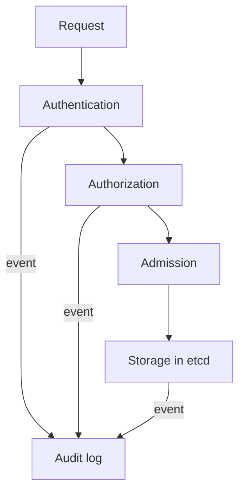

# The Audit Event Model

When you run `kubectl get secret`, the API server receives an HTTP request and processes it in steps. The audit system watches those steps and writes an event, which is one JSON object, for each request that the policy selects. To read a log you need to know when an event is written, how much it contains, and what each field means. This part covers all three, and ends with a look at a real record.

## Stages of a request

The audit system can write a record at four points in the life of a request. These points are called stages:

| Stage | When the API server records it |
| --- | --- |
| `RequestReceived` | As soon as the request arrives, before any handler runs. |
| `ResponseStarted` | After the response headers are sent, but before the body. Only for long-running requests such as `watch`. |
| `ResponseComplete` | After the response body is sent. This is the stage with the final status code. |
| `Panic` | When the handler fails with an internal error. |

Most requests produce a `RequestReceived` event and a `ResponseComplete` event. The first has no result, so most policies omit it with `omitStages`. Searching for the outcome of a request means looking at `ResponseComplete`.

## Levels of detail

The policy sets a level for each request. The level decides how much is written:

| Level | What the event contains |
| --- | --- |
| `None` | Nothing. The request is not logged. |
| `Metadata` | Who, what, when and the result. No request body and no response body. |
| `Request` | The metadata and the request body. No response body. |
| `RequestResponse` | The metadata, the request body and the response body. |

The level is a trade-off. `Metadata` is small and safe. `Request` and `RequestResponse` can contain the full object, which for a Secret includes its data. A log with Secret bodies is itself a sensitive file. The common practice is `Metadata` for Secrets and ConfigMaps, and a higher level only for objects where the body is needed and holds no credentials.



The diagram shows that the audit system observes the request as it passes the checks and writes the event to the log.

## Fields of an event

An event is a JSON object with a fixed set of fields. These are the ones used most:

| Field | Meaning |
| --- | --- |
| `auditID` | A unique ID for the request. All stages of one request share it. |
| `stage` | One of the four stages. |
| `verb` | The Kubernetes verb, such as `get`, `list`, `create`, `delete`. |
| `user.username` and `user.groups` | The authenticated identity. |
| `impersonatedUser` | Set when the caller used `--as`. The identity used for authorization. |
| `sourceIPs` | Source addresses of the request. |
| `userAgent` | The client program, such as `kubectl`. |
| `objectRef` | `resource`, `subresource`, `namespace`, `name`, `apiGroup`, `apiVersion`. |
| `responseStatus.code` | The HTTP status code. |
| `annotations` | Extra facts, such as `authorization.k8s.io/decision` with the value `allow` or `forbid`. |
| `requestObject`, `responseObject` | The bodies. Present only at the levels `Request` and `RequestResponse`. |

The ServiceAccount username has the form `system:serviceaccount:<namespace>:<name>`. The `user.extra` map can carry extra facts about the credential, such as the Pod name for a projected token.

## Look at a real record

Select the playground cluster and trigger a read of the disposable Secret:

<!-- astrona:playground:renew -->

```sh
export KUBECONFIG="$(astrona kubeconfig ats-036-playground-050-01)"
kubectl config current-context
node_name="astro-ats-036-playground-050-01-control-plane"
kubectl -n starfleet get secret audit-token -o name
```

The command prints `secret/audit-token`. Wait a moment for the file write, then read the newest records of the audit log on the control plane node and format them:

```sh
podman exec "$node_name" tail -n 40 /var/log/training-audit/audit.jsonl | grep audit-token | tail -n 1 | python3 -m json.tool
```

The output is one event. Check these fields in it. `stage` is `ResponseComplete`, `verb` is `get`, `user.username` is the cluster administrator identity from your kubeconfig, `userAgent` starts with `kubectl`, `objectRef.resource` is `secrets`, `objectRef.name` is `audit-token`, and `responseStatus.code` is `200`. The event has no `requestObject` and no `responseObject`, because the policy level is `Metadata`.

If the command prints nothing, read a larger number of lines with `tail -n 200`. Other components also write events, so the newest line is not always yours.

## Common pitfalls

> [!WARNING]
> - **Searching `RequestReceived` for outcomes.** That stage has no status code. Use `ResponseComplete`.
> - **Logging `RequestResponse` for Secrets.** The log then holds credentials in clear text. Use `Metadata`.
> - **Trusting `user.username` without checking `impersonatedUser`.** A caller can act as another identity. Both fields show the full picture.
> - **Assuming one request is one line.** Each stage writes its own line with the same `auditID`.
> - **Ignoring the log file as sensitive data.** It lists names of objects and identities. Restrict who can read it.
