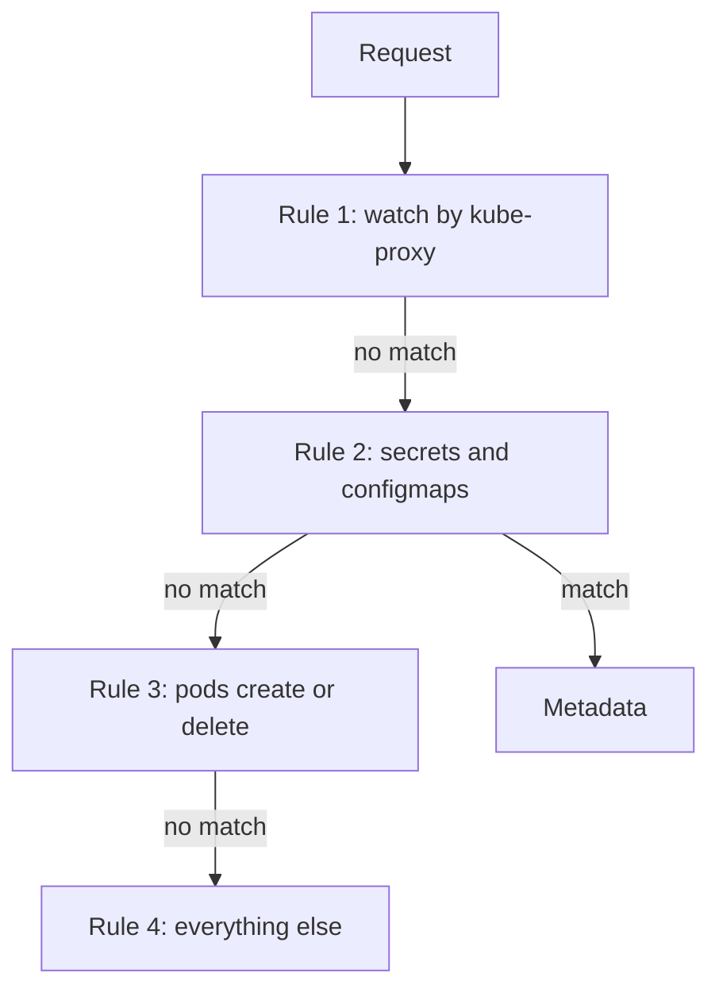

# Writing An Audit Policy

An audit policy is a file that tells the API server which requests to record and at which level. Without a policy, the API server records nothing, and with a policy that is too broad, the log grows fast and hides the events that matter. This part shows the structure of a policy, the rule that decides which rule applies, and a request that a typical policy does not record.

## Structure of a policy

A policy is an object of kind `Policy` in the group `audit.k8s.io/v1`. It has a list of `rules` and, optionally, `omitStages`. Each rule can match on users, user groups, verbs, namespaces, resources and non-resource URLs. A rule that matches sets the level.

The API server checks the rules from top to bottom. The first rule that matches a request decides the level, and the later rules are ignored. A request that matches no rule is not logged at all. The order of the rules is therefore part of the meaning of the policy.

Here is a policy in YAML with a common shape. This policy is for reading. The playground uses an equivalent policy that you inspect below, and you do not apply this one:

```yaml
apiVersion: audit.k8s.io/v1
kind: Policy
omitStages:
  - "RequestReceived"
rules:
  - level: None
    users: ["system:kube-proxy"]
    verbs: ["watch"]
  - level: Metadata
    resources:
      - group: ""
        resources: ["secrets", "configmaps"]
  - level: Request
    resources:
      - group: ""
        resources: ["pods"]
    verbs: ["create", "delete"]
  - level: Metadata
```

The first rule drops the noisy watch requests of `kube-proxy`. The second records Secrets and ConfigMaps at `Metadata`, so no bodies are written. The third records the body of Pod creation and deletion. The last rule has no filters, so it records everything else at `Metadata`.

## Order matters

Consider a request to read a Secret. It does not match the first rule, because the user is not `system:kube-proxy`. It matches the second rule, so the API server records it at `Metadata` and stops. Now imagine the last rule, which has no filters, at the top of the list. It would match every request, and the more specific rules below it would never run. Put narrow rules first and the broad rule last.



The diagram shows the evaluation order. The first matching rule ends the search.

## Inspect the playground policy

Read the policy of the playground from the control plane node:

<!-- astrona:playground:renew -->

```sh
export KUBECONFIG="$(astrona kubeconfig ats-036-playground-050-01)"
kubectl config current-context
node_name="astro-ats-036-playground-050-01-control-plane"
podman exec "$node_name" cat /etc/kubernetes/training-audit-policy.json
```

The file is one line of JSON. It omits the `RequestReceived` stage. Its first rule records `secrets`, `configmaps` and `pods` in the namespace `starfleet` at `Metadata`. Its second rule has level `None` without any filter, so every other request is not recorded. This is a narrow policy for training. A production policy usually ends with a broad `Metadata` rule and not with `None`.

## See what the policy skips

Save this as `audit-count.py`. It reads audit events from standard input and counts them by resource, subresource and verb:

```python
import json
import sys
from collections import Counter

counts = Counter()
for line in sys.stdin:
    event = json.loads(line)
    reference = event.get("objectRef", {})
    key = (reference.get("resource", "-"), reference.get("subresource", "-"), event["verb"])
    counts[key] += 1

for (resource, subresource, verb), total in sorted(counts.items()):
    print(resource, subresource, verb, total)
```

Generate five requests. Two are inside the rules, and three are outside:

```sh
kubectl -n starfleet get secret audit-token -o name
kubectl -n starfleet get configmap probe-code -o name
kubectl -n starfleet get deployment probe -o name
kubectl -n outpost get pod drifter -o name
kubectl -n starfleet exec shuttle -- true
```

Then check the result:

```sh
podman exec "$node_name" cat /var/log/training-audit/audit.jsonl | python3 audit-count.py
```

The output lists lines of the form `resource subresource verb total`. You find `secrets - get`, `configmaps - get` and `pods - get`, which is the Pod read that `kubectl exec` does first. You find no line for `deployments`, because no rule matches Deployments and the last rule has level `None`. You find no line for the `outpost` namespace, for the same reason. You find no line for `pods exec`, because the resource name `pods` in a rule does not match the subresource `pods/exec`. The totals are higher than your own requests, because the controller manager and the kubelet also read these objects.

## Close the exec gap

To record `exec`, add the subresource to the rule, for example `resources: ["pods", "pods/exec"]`, or use the wildcard `pods/*`. Commands run inside containers are among the most important events to keep, because an attacker with API access often uses `exec`. In a real cluster, record `pods/exec` and `pods/attach` at `Request` or `Metadata`.

Together, the structure, the order and the filters decide what the log can answer later. An event that no rule selected cannot be reconstructed. The next question is how the API server gets the policy file and where the log is written.

## Common pitfalls

> [!WARNING]
> - **Placing a broad rule before a specific one.** The first match wins, so the specific rule never runs.
> - **Forgetting subresources.** `pods` does not cover `pods/exec`, `pods/log` or `pods/portforward`.
> - **Ending with `level: None` in production.** Requests that no earlier rule selected are lost. End with a `Metadata` rule.
> - **Recording high-volume noise.** Watches and health checks from system components fill the log. Drop them with early `None` rules.
> - **Using `RequestResponse` on Secrets.** Credentials enter the log.
