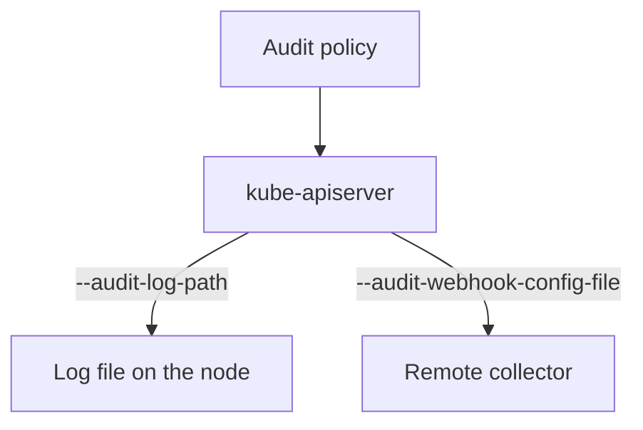

# API Server Flags, Backends And Troubleshooting

A policy file does nothing until the API server is told to load it and to write the result somewhere. On a kubeadm or `kind` cluster, the API server runs as a static Pod, which is a Pod that the kubelet starts from a manifest file on the control plane node. This part shows the flags that turn audit on, the two backends that receive the events, and the checks to run when the log stays empty or the API server does not start.

## Flags of the log backend

The log backend writes events to a file on the control plane node. It needs a policy flag and a path flag. The rotation flags keep the file from growing without limit.

| Flag | Meaning |
| --- | --- |
| `--audit-policy-file` | Path to the policy. Without it, auditing is off. |
| `--audit-log-path` | Path of the log file. The value `-` writes to standard output. |
| `--audit-log-maxage` | Days to keep old files. |
| `--audit-log-maxbackup` | Number of old files to keep. |
| `--audit-log-maxsize` | Size in megabytes at which the file rotates. |
| `--audit-log-format` | `json` (default) or `legacy`. |
| `--audit-log-mode` | `blocking` (default), `batch` or `blocking-strict`. |

Because the API server runs in a container, the policy file and the log directory must be mounted into it. In a static Pod this means two `hostPath` volumes and two `volumeMounts`. If a mount is missing, the API server cannot read the policy or write the log.

## Inspect the flags in the playground

Select the playground cluster and read the audit flags from the manifest of the API server:

<!-- astrona:playground:renew -->

```sh
export KUBECONFIG="$(astrona kubeconfig ats-036-playground-050-01)"
kubectl config current-context
node_name="astro-ats-036-playground-050-01-control-plane"
podman exec "$node_name" grep -e '--audit' /etc/kubernetes/manifests/kube-apiserver.yaml
```

The output has five lines. They set the policy file to `/etc/kubernetes/training-audit-policy.json`, the log path to `/var/log/training-audit/audit.jsonl`, the maximum age to `1`, the number of backups to `1` and the maximum size to `10`. These small rotation values suit a training cluster. A production cluster keeps more history and sends events to a central store.

Check that the mounts exist for both paths:

```sh
podman exec "$node_name" grep -n -A3 'training-audit' /etc/kubernetes/manifests/kube-apiserver.yaml
```

The matching lines show a volume for the policy file of type `File`, a volume for the log directory of type `DirectoryOrCreate`, and the matching `volumeMounts`. The policy mount is read-only. The log mount is writable.

Then check the log file on the node:

```sh
podman exec "$node_name" ls -l /var/log/training-audit
```

The listing shows `audit.jsonl` and, after rotation, backup files with a timestamp in the name. Read the manifest only. Changing it makes the kubelet restart the API server, and a mistake can leave the cluster without an API.

## The webhook backend

The webhook backend sends events over HTTPS to a remote service, such as a log collector. The flag `--audit-webhook-config-file` points to a file in kubeconfig format that holds the address and the credentials of the service. The flag `--audit-webhook-mode` sets how events are sent:

- `batch` buffers events and sends them in groups. The API server does not wait for the service. If the buffer fills, events are dropped. This is the default.
- `blocking` makes each request wait until its event is sent.
- `blocking-strict` also fails the request if the audit event cannot be written.

The log backend and the webhook backend can run together. The same policy applies to both.



The diagram shows one API server writing the same events to a file and to a remote service.

## Troubleshoot an empty log or a failed start

Start with the symptom. If the API server does not start after a change, the likely cause is a path that does not exist in the container, a policy file that is not valid, or a missing volume mount. Because the API is down, `kubectl` cannot help. Use the container runtime on the node instead:

```sh
podman exec "$node_name" crictl ps -a --name kube-apiserver
```

This lists the API server containers with their state, so you can see a container that exits again and again. The command `crictl logs` with the container ID prints the message, which names the file or flag at fault.

If the API server runs but the log stays empty, check three things in order. First, the policy has a rule that matches your request. Second, the log path is on a mounted directory. Third, the user running the container can write to it. A request that no rule selects leaves no record, which looks the same as a broken log.

Test that the API is ready:

```sh
kubectl get --raw=/readyz
```

The command prints `ok` when the API server is healthy. With all pieces in place, the log fills with events from every client of the API. The next part reads those events to answer access questions.

## Common pitfalls

> [!WARNING]
> - **Setting the flag without the mount.** The API server fails to start or cannot write. Add both the volume and the `volumeMounts` entry.
> - **Using small rotation values on a busy cluster.** A small size or age discards history before an investigation needs it.
> - **Editing the manifest on a live cluster without a plan.** The API server restarts. Keep a copy of the original file.
> - **Treating `batch` as lossless.** If the collector is slow, events are dropped. Use `blocking` where every event must arrive.
> - **Leaving the log world-readable.** The file lists identities and object names. Restrict access on the node.
