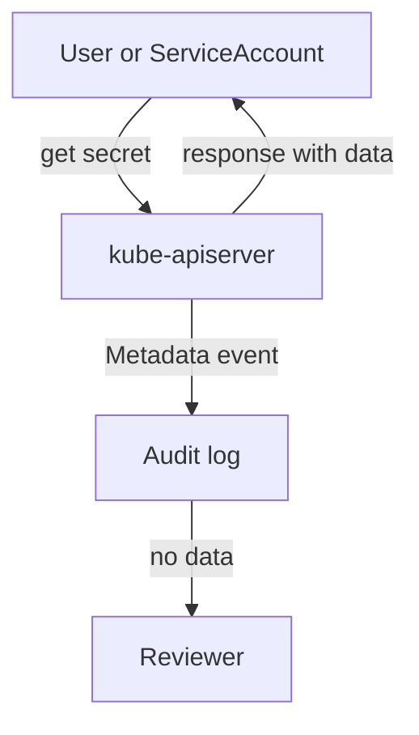

# Reading Audit Records To Monitor Access

An audit log is only useful when you can ask it questions. For access monitoring, the first questions are who read a Secret, who tried and was denied, and whether the log itself leaks the data it is meant to protect. This part generates a read and a denied request, finds both in the log with a short script, and checks that the Metadata level leaves request and response bodies out.

## Generate two kinds of access

A successful read and a denied read leave different records. The first uses the cluster administrator identity from your kubeconfig. The second uses impersonation, which is the `--as` option of `kubectl`. It sends the request as the default ServiceAccount of the `outpost` namespace, which has no permissions.

<!-- astrona:playground:renew -->

```sh
export KUBECONFIG="$(astrona kubeconfig ats-036-playground-050-01)"
kubectl config current-context
node_name="astro-ats-036-playground-050-01-control-plane"
kubectl -n starfleet get secret audit-token -o name
kubectl -n starfleet get secret audit-token --as=system:serviceaccount:outpost:default
```

The first command prints `secret/audit-token`. The second fails with a `Forbidden` message that names the ServiceAccount and the Secret. Both requests reached the API server and both were audited, because the policy matches on the resource and not on the outcome.

## Report Secret access from the log

Save this as `audit-secret-report.py`. It reads events from standard input, keeps the `ResponseComplete` events for Secrets, and prints the identity, the verb, the object, the status code and whether a body is present:

```python
import json
import sys

for line in sys.stdin:
    event = json.loads(line)
    reference = event.get("objectRef", {})
    if event["stage"] != "ResponseComplete" or reference.get("resource") != "secrets":
        continue
    caller = event["user"]["username"]
    impersonated = event.get("impersonatedUser", {}).get("username", "-")
    decision = event.get("annotations", {}).get("authorization.k8s.io/decision", "-")
    has_body = "requestObject" in event or "responseObject" in event
    print(
        caller,
        impersonated,
        event["verb"],
        reference.get("name", "-"),
        event["responseStatus"]["code"],
        decision,
        "body" if has_body else "no-body",
    )
```

Then run it on the log from the control plane node:

```sh
podman exec "$node_name" cat /var/log/training-audit/audit.jsonl | python3 audit-secret-report.py
```

Look for two lines that name `audit-token`. The first line shows the administrator identity as the caller, `-` as the impersonated user, the verb `get`, the code `200`, the decision `allow` and `no-body`. The second shows the same caller, the impersonated user `system:serviceaccount:outpost:default`, the code `403`, the decision `forbid` and `no-body`. The caller field stays the real user. The impersonated field shows the identity used for authorization. Other lines can appear for components that read Secrets in the namespace.

## What the Metadata level keeps out

The policy level for Secrets is `Metadata`. The report prints `no-body` for every line, which shows that no event contains `requestObject` or `responseObject`. The disposable value `audit-disposable` is stored in the Secret, so search the whole log for it:

```sh
podman exec "$node_name" grep -c 'audit-disposable' /var/log/training-audit/audit.jsonl
```

The count is `0`. The log records that the Secret was read, but not its content. Changing the Secret rule to `RequestResponse` would put the Secret data, base64 encoded, into every read response event. Base64 is an encoding and not encryption, so anyone with the log can decode the value.



The diagram shows that the caller receives the Secret data, while the log receives only the metadata of the request.

## Questions the log can answer

Once a record is found, use its fields to answer the usual access questions:

- Who read the Secret: `user.username`, with `impersonatedUser` when set.
- From where: `sourceIPs` and `userAgent`. A ServiceAccount request from a Pod comes from the Pod address, and `user.extra` can name the Pod for projected tokens.
- Was it allowed: `responseStatus.code` and the annotation `authorization.k8s.io/decision`.
- When: the field `requestReceivedTimestamp` and `stageTimestamp`.
- Which object: `objectRef`.

A burst of `403` results from one identity against many resources suggests discovery by someone with a stolen token. A `get` of a Secret by a ServiceAccount that never read it before is also worth review. Without a baseline of normal access, such events are only a lead, not proof.

## Common pitfalls

> [!WARNING]
> - **Reading only successful requests.** Denied requests show attempts and are often the first sign of misuse.
> - **Confusing caller and impersonated user.** Report both fields.
> - **Assuming the log is empty because a name is not found.** Check the namespace, the stage and the rotation state of the file.
> - **Raising the level to see more.** `Request` and `RequestResponse` can write Secret data into the log. Keep `Metadata`.
> - **Treating a clean log as proof of no access.** A request the policy skips leaves no record.
