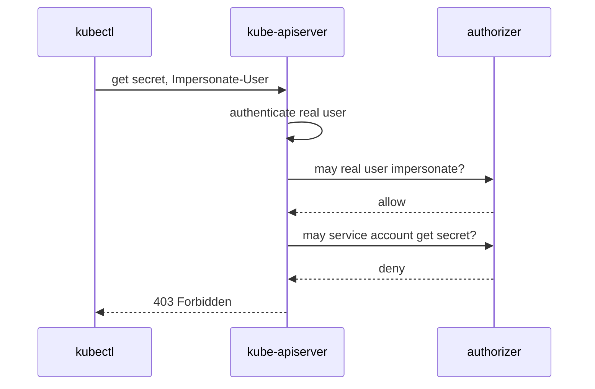

---
exam_objectives:
- Use Kubernetes audit logs to monitor access
---
# Impersonation And The Identity In An Audit Record

An audit record names an identity, but a request can carry two of them. When an administrator tests what a ServiceAccount may do, or when a tool acts for a user, the API server records both the identity that sent the request and the identity it acted as. A report that copies the wrong field blames the wrong account. This part explains how impersonation works inside the API server, which field holds which identity, and which questions the other fields of a record can answer.

## How the API server handles an impersonated request

Impersonation lets an authenticated user send a request as another user or ServiceAccount. The `kubectl` option `--as` turns it on. For example, `kubectl -n starfleet get secret audit-token --as=system:serviceaccount:outpost:default` sends a normal `get` request with one extra HTTP header, `Impersonate-User`, that holds the ServiceAccount name. The option `--as-group` adds an `Impersonate-Group` header in the same way.

The API server handles such a request in three steps. First, the authentication step checks the real credentials from the kubeconfig, for example the administrator certificate. Second, the API server asks the authorizer whether this real user may use the `impersonate` verb on the target. For a ServiceAccount, the target is the resource `serviceaccounts` with that name in its namespace; for a user, it is the resource `users`. Third, when that check passes, the API server replaces the identity of the request with the impersonated one. Every later step, including the authorization of the `get` on the Secret, sees only the impersonated identity.

The diagram shows that the authorizer runs twice: once for the real user and the `impersonate` verb, and once for the impersonated identity and the real request.

This order explains the denied read in the playground. The administrator may impersonate any account, so the first check passes. The default ServiceAccount of `outpost` has no permissions, so the second check fails and the API server answers `403`. The `Forbidden` message names the ServiceAccount, not the administrator, because the second check ran as the ServiceAccount. If the first check fails instead, the message says that the real user cannot impersonate the target, and the real request is never authorized at all.

## Two identities in one record

The audit system writes both identities into the event. The field `user` holds the identity that the authentication step found, that is, the real caller. The field `impersonatedUser` holds the identity that the API server acted as. A request without impersonation has no `impersonatedUser` field at all.

The denied read from the playground shows the pattern. Its `ResponseComplete` event has the administrator identity in `user.username`, `system:serviceaccount:outpost:default` in `impersonatedUser.username`, the verb `get`, the code `403` and the annotation `authorization.k8s.io/decision` set to `forbid`. The decision belongs to the impersonated identity, because that identity is the one the authorizer checked for the `get`.

Read the two fields as two different facts. The `user` field tells you who holds the credentials that sent the request, so it is the person or system to ask about it. The `impersonatedUser` field tells you whose permissions were tested, so it is the account whose Role or RoleBinding explains the result. An incident report needs both: a request that shows a ServiceAccount in `impersonatedUser` was not sent by a Pod with that ServiceAccount token.

## Questions the log can answer

Once a record is found, its other fields answer the usual access questions. Each answer comes from a field that the API server filled in itself:

- Who sent the request: `user.username`. Who it acted as: `impersonatedUser.username`, when the field is present.
- From where: `sourceIPs` and `userAgent`. A ServiceAccount request from a Pod comes from the Pod address, and `user.extra` can name the Pod for projected tokens.
- Was it allowed: `responseStatus.code` and the annotation `authorization.k8s.io/decision`.
- When: the fields `requestReceivedTimestamp` and `stageTimestamp`.
- Which object: `objectRef`.

A burst of `403` results from one identity against many resources suggests discovery by someone with a stolen token. A `get` of a Secret by a ServiceAccount that never read it before is also worth review. Without a baseline of normal access, such events are only a lead, not proof.

You now know that `kubectl --as` adds an `Impersonate-User` header, that the authorizer checks the `impersonate` verb for the real user before it checks the request for the impersonated identity, and that the audit event keeps the two identities apart in `user` and `impersonatedUser`. The open question for any report is which of the two identities to act on, and the answer depends on whether the problem is the credentials that sent the request or the permissions that decided it.

## Common pitfalls

> [!WARNING]
> - **Confusing caller and impersonated user.** `user` is the real caller and `impersonatedUser` is the identity the API server acted as. Report both fields.
> - **Blaming a Pod for an impersonated request.** A ServiceAccount in `impersonatedUser` means someone else sent the request as that account, not that a Pod used its token.
> - **Reading the decision as the caller's.** The `authorization.k8s.io/decision` annotation belongs to the identity the authorizer checked for the request, which is the impersonated one.
> - **Forgetting that impersonation is a permission.** The `impersonate` verb on `users` or `serviceaccounts` is a powerful right. Any account that holds it can act as the target.
