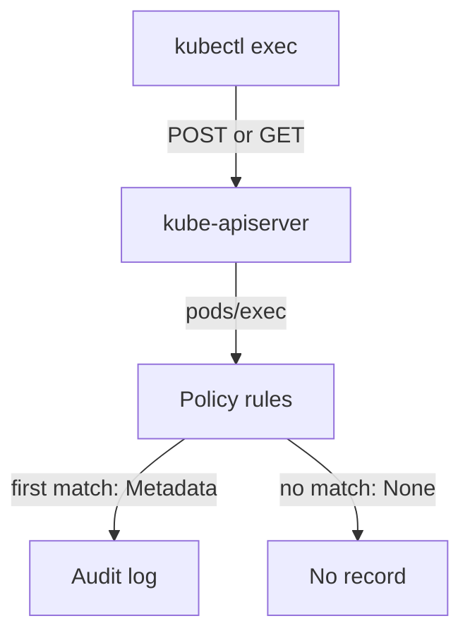

# Subresources In Audit Policy Rules

An administrator who wants to know who opened a shell in a Pod writes a rule for `pods` and finds nothing in the log. The reason is that an exec request is not a request for the Pod. It is a request for a subresource of the Pod. This part explains what a subresource is, which ones matter for access monitoring and how a rule must name them.

## What a subresource is

A subresource is an extra endpoint under one object. The API server serves it at the path of the object plus a suffix. The Pod `shuttle` in the namespace `starfleet` has the path `/api/v1/namespaces/starfleet/pods/shuttle`. The same Pod has these subresource paths, among others:

| Subresource | What the request does |
| --- | --- |
| `pods/exec` | Runs a command in a container and connects its input and output to the client. |
| `pods/attach` | Connects the client to the main process of a container. |
| `pods/portforward` | Opens a tunnel from the client to a port of the Pod. |
| `pods/log` | Reads the log of a container. |
| `pods/ephemeralcontainers` | Adds a debug container to a running Pod. |
| `serviceaccounts/token` | Requests a new token for a ServiceAccount. |

The first four give a person a direct line into a workload. The last two change what runs in the Pod or create a credential. All six are worth recording in a cluster where access is monitored.

## How a rule names a subresource

An audit rule selects requests with the field `resources`. Each entry has an API group and a list of resource names. The core group is written as an empty string. A rule that lists `pods` matches requests to Pod objects only. It does not match `pods/exec`, because the audit system compares the full name, including the suffix.

Rules can name a subresource in three ways. Write the full name, such as `pods/exec`. Write `pods/*` to match every subresource of Pods. Or write `*/exec` to match the `exec` subresource of any resource. The playground policy uses full names. You read it from the control plane node. Start by selecting the playground, then print the policy:

<!-- astrona:playground:renew -->

```sh
export KUBECONFIG="$(astrona kubeconfig ats-036-playground-050-02)"
kubectl config current-context
node_name="astro-ats-036-playground-050-02-control-plane"
podman exec "$node_name" cat /etc/kubernetes/training-audit-policy.json
```

The policy is one line of JSON. It has the field `omitStages` set to `RequestReceived`, a first rule at the level `Metadata` for `pods/exec`, `pods/portforward` and `pods/log` in the `starfleet` namespace, a second rule for Secrets and ConfigMaps, and a final rule at the level `None`. Because the first matching rule wins, an exec request is recorded by the first rule and never reaches the final rule.

## Where the subresource appears in the event

An event that the rule records has an `objectRef` field. For an exec request, `objectRef.resource` is `pods`, `objectRef.subresource` is `exec`, `objectRef.name` is the Pod name and `objectRef.namespace` is the namespace. The field `requestURI` holds the full path and the query string, including the command and the container. This is why a rule on `pods` and a search on `resource=pods` look similar and still give different results: the policy compares `pods/exec` as one name, while the event stores the resource and the subresource in two fields.



The diagram shows that the policy decides, request by request, whether an exec request reaches the log.

## What this means for a policy

A policy that was written for object changes often has a rule for `pods` and misses every interactive request. The rule looks complete and the log looks normal, because exec requests leave no record at all. The cost shows up later, during an investigation, when the log cannot say who opened a shell. A review of a policy therefore checks the subresources by name. This part showed which subresources exist and how a rule names them. The next part runs an exec request and reads the record it leaves.

## Common pitfalls

> [!WARNING]
> - **Writing `pods` and expecting `pods/exec`.** The names are compared in full. List each subresource or use `pods/*`.
> - **Searching for the exec request under the resource name only.** Look at `objectRef.subresource` as well.
> - **Assuming a quiet log means nobody opened a shell.** A rule that does not match leaves no trace.
> - **Placing a broad rule above the subresource rule.** The first matching rule wins and can lower the level or drop the request.
