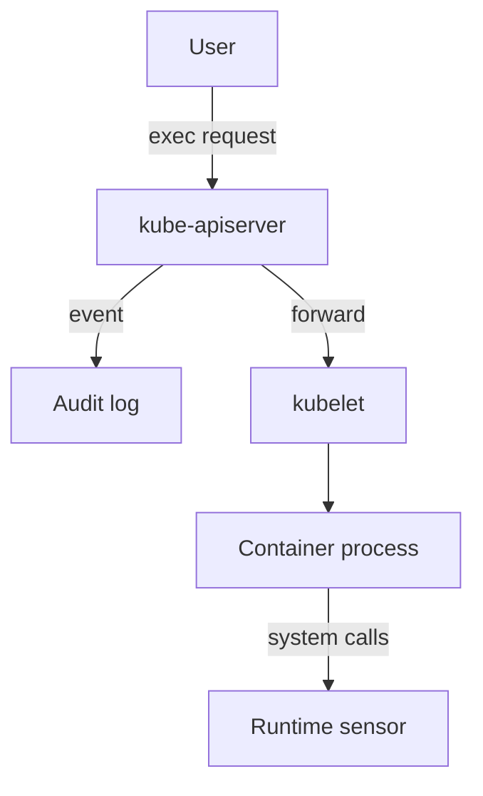

# Recording And Reading Exec Events

A rule is only a claim until a real request proves it. This part runs a command in the `shuttle` Pod, finds the record that the request left in the audit log, and reads the user, the Pod and the command from it. It then shows what the record does not contain.

## Run a command through the API server

The `kubectl exec` command sends a request to the API server. The API server authenticates the user, authorizes the request and then forwards the connection to the kubelet on the node that runs the Pod. The audit system sees the request at the API server, before the connection is forwarded. Run a short command in the `shuttle` Pod:

<!-- astrona:playground:renew -->

```sh
export KUBECONFIG="$(astrona kubeconfig ats-036-playground-050-02)"
kubectl config current-context
node_name="astro-ats-036-playground-050-02-control-plane"
kubectl -n starfleet exec shuttle -- id
```

The command prints the user and group IDs of the process in the container. The audit record for this request exists now, even though the command output went only to your terminal.

## Read the record with a script

Save this as `audit-pod-access.py`. It reads events from standard input and prints one line for each `ResponseComplete` event that names a Pod subresource:

```python
import json
import sys

for line in sys.stdin:
    event = json.loads(line)
    reference = event.get("objectRef", {})
    if event["stage"] != "ResponseComplete" or not reference.get("subresource"):
        continue
    if reference.get("resource") != "pods":
        continue
    print(
        event["user"]["username"],
        event["verb"],
        reference["subresource"],
        reference.get("name", "-"),
        event.get("responseStatus", {}).get("code", "-"),
        event["requestURI"],
    )
```

Run it on the log from the control plane node:

```sh
podman exec "$node_name" cat /var/log/training-audit/audit.jsonl | python3 audit-pod-access.py
```

Look for a line with the subresource `exec` and the Pod name `shuttle`. The user is the identity from your kubeconfig. The `requestURI` ends with a query string that contains `command=id`, and it can also name the container and the options `stdin`, `stdout` and `tty`. Lines for `log` can appear as well, because tools and controllers read Pod logs.

## Which verb and which stage

The verb of an exec record depends on how the client connected. Older clients send a `POST` request, which the audit system records as the verb `create`. Newer clients can use a WebSocket connection, which starts with a `GET` request. For this reason, do not filter exec records by verb. Filter by `objectRef.subresource`.

Exec is a long-running request, so the log can hold a `ResponseStarted` event and a `ResponseComplete` event for the same `auditID`. The first is written when the connection is accepted. The second is written when the connection ends. The report above uses `ResponseComplete`, which also shows how the request ended.

## What the record proves and what it does not

The record proves that a named identity asked the API server to run a command in a named container, from a source address, at a time, and whether the API server accepted the request. It does not hold the output of the command, the input the user typed in an interactive shell or the files the user changed. A user who opens a shell with `kubectl exec -it -- sh` produces one record with `command=sh`, and everything done inside that shell is invisible to the API audit log.

Runtime security tools fill that gap. They watch system calls on the node and see the commands run inside the shell. The audit log answers who got in. A runtime sensor answers what they did. An investigation uses both.



The diagram shows that the audit log sees the request at the API server, while only a runtime sensor sees the process inside the container.

This part found one exec record and read it. The open question is how to choose rules and levels so that interactive access is recorded without filling the log with noise.

## Common pitfalls

> [!WARNING]
> - **Filtering exec records by the verb `create`.** A WebSocket client produces a `get`.
> - **Reading only `RequestReceived`.** The playground policy omits that stage. The outcome is in `ResponseComplete`.
> - **Expecting the command output in the log.** The log holds the request, not the session.
> - **Treating one `sh` record as the full story.** What happened inside the shell needs a runtime sensor.
