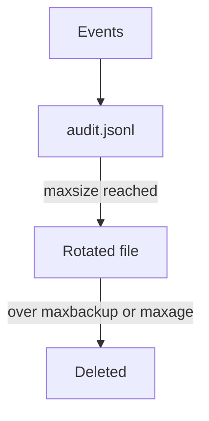

# Rotation Flags And Disk Use

The API server appends one JSON line for every recorded event, and the file grows without limit unless rotation is set. Rotation keeps the disk from filling, but it also deletes evidence. This part reads the rotation flags from a running cluster and works out how much evidence they keep.

## The three rotation flags

The log backend of the API server rotates the file with three flags:

| Flag | Meaning |
| --- | --- |
| `--audit-log-maxsize` | The size in megabytes at which the API server closes the file and starts a new one. |
| `--audit-log-maxbackup` | The number of rotated files to keep. The value `0` keeps all of them. |
| `--audit-log-maxage` | The number of days to keep a rotated file, counted from the time in its name. The value `0` sets no age limit. |

A rotated file gets a timestamp in its name, for example `audit-2026-11-03T10-00-00.000.jsonl`. When either limit is reached, the API server deletes the oldest rotated file. The flag `--audit-log-compress` compresses rotated files, which reduces disk use and keeps the file count the same.

## Read the flags from the cluster

The API server runs as a static Pod. The kubelet starts it from `/etc/kubernetes/manifests/kube-apiserver.yaml` on the control plane node. Select the playground and print every audit flag in that file:

<!-- astrona:playground:renew -->

```sh
export KUBECONFIG="$(astrona kubeconfig ats-036-playground-050-03)"
kubectl config current-context
node_name="astro-ats-036-playground-050-03-control-plane"
podman exec "$node_name" grep -o -- '--audit-[a-z-]*=[^"]*' /etc/kubernetes/manifests/kube-apiserver.yaml
```

You see the policy file, the log path and the three rotation flags. In this playground the values are `1` for the maximum age in days, `1` for the number of backups and `10` for the maximum size in megabytes. Then list the log directory on the node:

```sh
podman exec "$node_name" ls -l /var/log/training-audit
```

The directory holds the active file `audit.jsonl` and any rotated files. A cluster that has only started has no rotated file yet.

## How much evidence the flags keep

The largest disk use is the size limit multiplied by the number of files, which is the backups plus the one active file. With `maxsize=10` and `maxbackup=1`, the log uses at most about 20 megabytes without compression. The shortest period that the log covers depends on how fast events arrive. If the cluster writes 10 megabytes in one hour, the two files cover about two hours, and the age limit of one day never applies. The size limit then decides retention, not the age limit.

This gives a rule for review. Estimate the event rate from the active file, then check that the size and backup limits cover the period that the organization needs for investigations. A busy cluster with small limits keeps minutes of evidence, which is too little to investigate an incident that was found a day later.



The diagram shows that a rotated file lives until the backup count or the age limit removes it.

This part showed how to read the limits and compute the evidence they keep. The next part asks who can read and change the file.

## Common pitfalls

> [!WARNING]
> - **Reading the age limit alone.** On a busy cluster the size and backup limits remove files first.
> - **Setting `maxbackup=0` and forgetting the disk.** All rotated files stay and can fill the node.
> - **Searching only `audit.jsonl`.** Older events are in the rotated files.
> - **Believing deletion is logged.** Rotation removes files silently.
