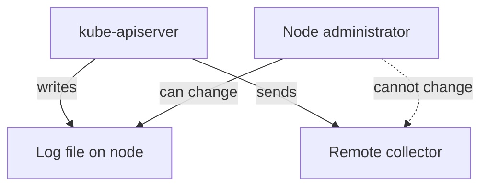

# Protecting The Log File

An audit log names every user, source address and object that the API server saw. That makes the file valuable to an attacker who wants to learn the cluster, and to an attacker who wants to hide an action. This part checks who can read and change the file on the node and decides what protection the file needs.

## What the file reveals

Metadata events hold user names, group names, source addresses, user agents, object names and request paths. A person who reads the log learns which ServiceAccounts exist, which Secrets are read and when, and which addresses connect. No Secret value is present when the level is `Metadata`, but the map of the cluster is complete. Treat the file as sensitive for this reason.

## Check the mode and the owner

The API server creates the file, so the owner and the mode come from the API server process, which runs as `root` in the kubeadm and `kind` layout. Print the owner, the mode and the name:

<!-- astrona:playground:renew -->

```sh
export KUBECONFIG="$(astrona kubeconfig ats-036-playground-050-03)"
kubectl config current-context
node_name="astro-ats-036-playground-050-03-control-plane"
podman exec "$node_name" stat -c '%a %U %n' /var/log/training-audit/audit.jsonl
```

The first field is the permission mode in octal notation. The second is the owner. Read the mode as three digits for the owner, the group and everybody else. A digit of `6` allows reading and writing, `4` allows reading only and `0` allows nothing. Use the number you see, and do not assume it, because it depends on how the file was created.

Then print the mode of the directory that holds the log:

```sh
podman exec "$node_name" stat -c '%a %U %n' /var/log/training-audit
```

The directory mode matters because a user who can write to the directory can delete or replace the file even if the file itself is read-only for that user.

## Protection that a node provides

On a node, the audit file is protected by the operating system and by the people who have access to the node. These measures reduce the risk:

- Keep the file and the directory owned by `root`, with no write access for others.
- Limit who can log in to control plane nodes, because any `root` user can read, change or delete the file.
- Send events to a remote system as well as to the file, so that deleting the file on the node does not erase the evidence.
- Keep the clocks of the nodes synchronized, so that events from several sources can be ordered.

The file on the node cannot prove that it is complete. A user with `root` can remove lines and the file will still parse. A copy that was sent to another system at write time is the stronger evidence, which is the reason for the webhook backend in the next part.



The diagram shows that the remote collector holds a copy that a node administrator cannot change.

This part found the owner and mode of the file and named the controls around it. The remaining question is how to get events off the node.

## Common pitfalls

> [!WARNING]
> - **Guessing the file mode.** Read it with `stat` on the node.
> - **Checking the file and not the directory.** Write access to the directory allows deletion.
> - **Treating a `Metadata` log as public.** It still maps users, objects and addresses.
> - **Trusting the local file alone.** A `root` user on the node can edit it.
